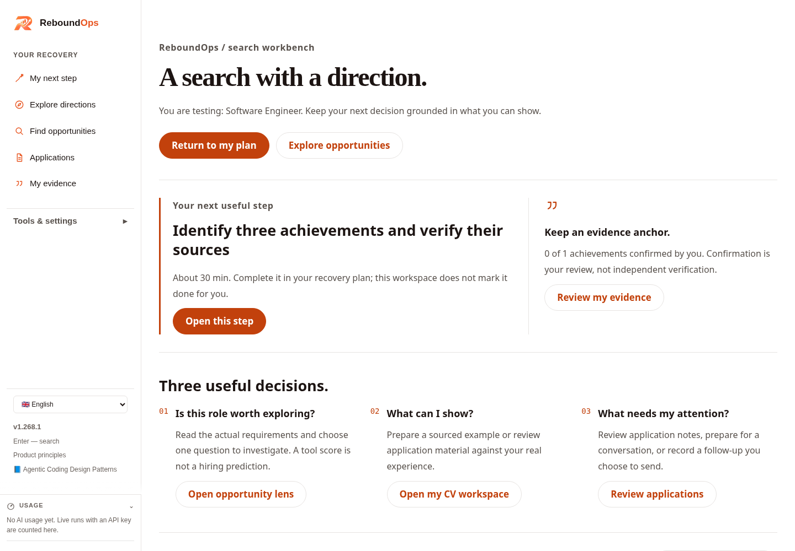
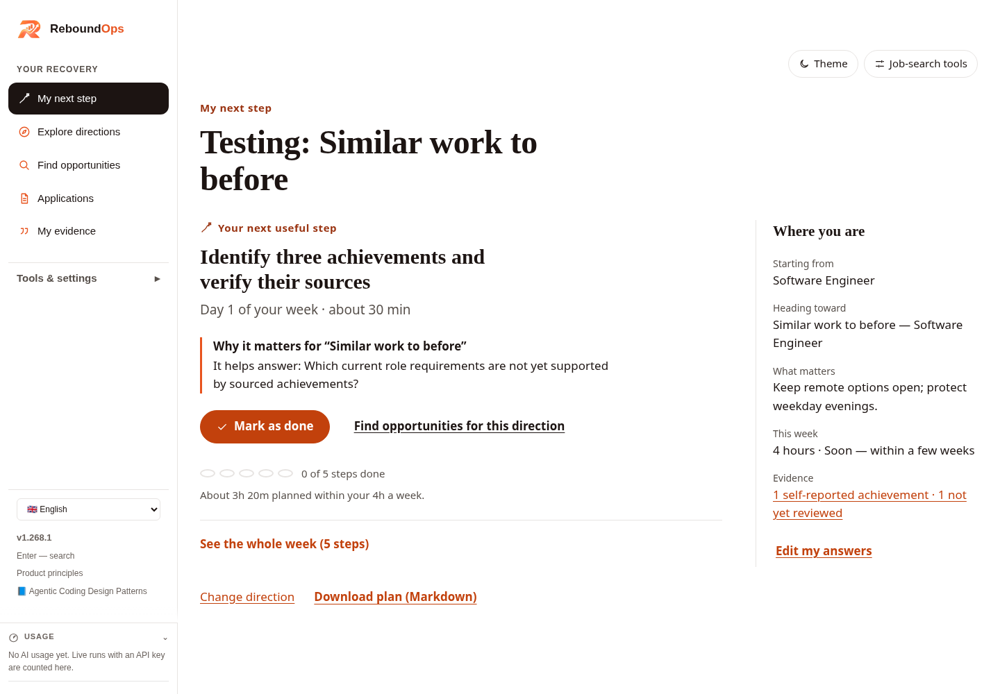
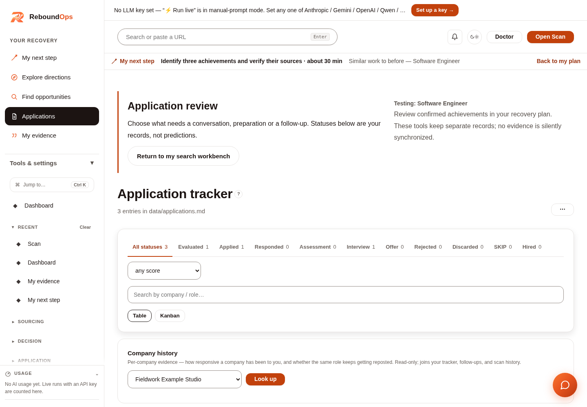

# ReboundOps

**Your experience. Your next chapter.**

A local-first toolkit for experienced software professionals navigating a layoff, a career change or their next job search. Review what your experience supports, choose a direction to explore, and manage the practical work of finding and applying for roles.

[Website](https://rebound-ops.org) · [Product screenshots](https://rebound-ops.org/screenshots/) · [Documentation](https://rebound-ops.org/docs/) · [Setup help](https://rebound-ops.org/help/) · [CI](https://github.com/AnkitParekh007/rebound-ops/actions/workflows/ci.yml) · [Roadmap](docs/roadmap.md)

## What you can do

| Work area | Capabilities in this repository |
| --- | --- |
| **Career recovery** | Guided intake, practical constraints, possible directions and a seven-day plan bounded by your available time. |
| **Evidence review** | Record achievements, attach exact quotations from pasted source excerpts, correct claims and explicitly review their status. |
| **Opportunity discovery** | Scan configured public job sources, filter results and organize selected opportunities in a pipeline. |
| **Job review** | Compare requirements with your experience, save evaluation reports and research a company before deciding what to do next. |
| **Application preparation** | Edit your CV, use CV Studio, prepare tailored documents and work through application checklists. AI and browser-based exports need their own setup. |
| **Application tracking** | Maintain statuses, notes and follow-up context; review your recorded search activity. |
| **Interview and development tools** | Prepare for interviews, practise responses, draft networking plans and explore learning or project ideas. |
| **Local data controls** | Recovery-session JSON backups, Markdown summaries and opt-in disk saving; file-based CV, tracker and reports for the job-search workspace. |

AI assistance is optional. Recovery directions are hypotheses to explore, and job-review scores are advisory signals—not hiring probabilities or guarantees. You choose what to pursue and submit applications yourself.

## Quick start

### Requirements

- **Node.js 24.15.0+ recommended.** The root application also supports Node 22.22.3+ and 26+, as declared in [package.json](package.json).
- **npm**, included with Node.js.
- **Bash and curl** for the integrated workspace launcher. On Windows, use WSL or a compatible Bash environment; the Angular development commands below do not require Bash.
- An AI provider key is **not required** for the recovery workflow.

### 1. Install the repository

```sh
git clone https://github.com/AnkitParekh007/rebound-ops.git
cd rebound-ops
npm ci
npm ci --prefix workspace --ignore-scripts
```

This monorepo already contains the recovery app, job-search workspace and engine. No second repository or remote installer is needed.

### 2. Start the integrated recovery and job-search demo

```sh
bash scripts/start-demo.sh
```

Open **http://127.0.0.1:4317/#/start**.

The launcher verifies locked dependencies for the root app, workspace and engine, installs Chromium when needed, checks that the browser can start, builds the recovery API and starts both local services. The first run needs network access for packages and the browser download. A fresh-checkout browser smoke test in CI covers PDF export, failure feedback and tracker writes. If Chromium reports missing Linux libraries, follow the printed `npx playwright install --with-deps chromium` instructions from `engine/` and rerun. Keep its terminal open; press **Ctrl+C** to stop them. Start with the fictional example to explore the screens before entering your own information.

### Choose the app mode that fits your task

| Mode | Command from the repository root | Address | Use it for |
| --- | --- | --- | --- |
| **Integrated workspace** | `bash scripts/start-demo.sh` | `http://127.0.0.1:4317/#/start` | Recovery screens followed by discovery, CV and application tools. |
| **Angular recovery app** | `npm run dev` | `http://127.0.0.1:4200` | The fuller evidence workflow, exact citations, requirement review, backups and opt-in persistence. |
| **Production-local recovery app** | `npm run build`, then `npm run start -w @reboundops/api` | `http://127.0.0.1:4174` | Serve the compiled Angular app and recovery API from one local process. |

The integrated workspace and Angular frontend are separate interfaces. Their recovery API is shared, but the integrated bridge exposes a narrower set of operations. The launcher serves the full recovery interface on port 4174 as well: choose **Open full recovery** to continue the same session without restarting. Start and My next step offer explicit local saving, JSON backup/restore and resume. Use **Download combined career backup** from Start or My next step for one private export of the current recovery session and eligible workspace records; restore previews file replacements. Provider settings and generated PDFs are excluded. Job-search files and recovery-session records are **not automatically synchronized**; CV, Profile and Two-pager offer editable, consent-based prefills before their own Save actions.

[Integrated demo guide](workspace/docs/INTEGRATION-DEMO.md) · [Demo walkthrough](workspace/docs/DEMO-WALKTHROUGH.md) · [Guided recovery onboarding](docs/onboarding.md)

## A practical workflow

1. **Describe your starting point.** Record your role, priorities, practical constraints and the time you can spend each week.
2. **Review your evidence.** Add achievements and check their wording. In the Angular app, connect claims to exact quotations from pasted résumé or project-note excerpts.
3. **Explore a direction.** Compare returning to similar work, shifting toward different work or trying a stepping-stone role. Review the assumptions and unknowns before selecting one.
4. **Make the next week manageable.** Generate a time-bounded plan, choose the next action and record progress or reflections.
5. **Work the search.** Use the job-search workspace to discover roles, review requirements, prepare application materials and maintain application records.
6. **Adjust from what happened.** Revisit your plan and search activity using your actual notes and outcomes.

The recovery app supports up to 15 achievement claims, three pasted source documents and three job targets per session. Confirming a claim records your review; it does not independently verify it. Correcting a confirmed claim resets its confirmation and revokes dependent requirement links.

## Workspace guide

With the integrated workspace running, these routes open inside the workspace:

| Page | Route | What to expect |
| --- | --- | --- |
| **My next step** | `#/recovery` | Your recovery snapshot, selected direction and next planned action. |
| **Directions** | `#/directions` | Options to explore, their assumptions and missing evidence. |
| **Evidence** | `#/evidence` | Review the achievements in your recovery session. |
| **Search workbench** | `#/dashboard` | Connect your next recovery action with opportunity, CV and application decisions. |
| **Scan** | `#/scan` | Search enabled sources and filter the returned opportunities. |
| **Pipeline** | `#/pipeline` | Organize job URLs waiting for review. |
| **Evaluate** | `#/evaluate` | Review a job description using configured AI assistance or a manual prompt. |
| **CV / CV Studio** | `#/cv`, `#/cv-studio` | Maintain your CV and prepare application material. |
| **Applications** | `#/tracker` | Review statuses, notes and follow-up context. |
| **Reports** | `#/reports` | Browse saved job-review reports. |
| **Mock interview** | `#/mock-interview` | Practise interview responses with configured assistance. |
| **Settings / Help** | `#/config`, `#/help` | Configure providers and read the in-app guide. |

Additional tools include statistics, interview preparation, networking, career planning, usage reporting and source configuration. Availability depends on the tool's configuration and supporting data. See the [workspace documentation](workspace/README.md).

## Screenshots

[Watch or download the launch videos](media/launch/README.md) — widescreen and LinkedIn formats.

These bundled captures use fictional demonstration data. The [website gallery](https://rebound-ops.org/screenshots/) shows the source commit and capture date for automatically generated production screenshots.



<details>
<summary>View recovery planning and application tracking</summary>

### Recovery plan



### Applications



</details>

## Configure your job search

The workspace uses `engine/` as its default job-search data directory.

| File or location | Purpose |
| --- | --- |
| `engine/cv.md` | Your working CV. |
| `engine/config/profile.yml` | Search preferences and profile configuration. |
| `engine/portals.yml` | Enabled sources, company boards and search filters. |
| `engine/data/pipeline.md` | Opportunities waiting for review. |
| `engine/data/applications.md` | Application records. |
| `engine/reports/` | Saved evaluation reports. |
| `engine/output/` | Generated application documents. |
| `engine/.env` | Workspace provider configuration; keep actual keys out of Git. |

Replace example profile information with your own before relying on an evaluation. Review bundled pipeline records too: fixture URLs and example companies are not real opportunities.

Supported source adapters include Greenhouse, Lever, Ashby, Workday, SmartRecruiters, Personio and others. Coverage depends on enabled boards, source availability and filters; a listed adapter does not imply access to every employer or a partnership.

For a prepared data directory outside the checkout, the workspace supports `REBOUND_OPS_ROOT`. Recovery-session saving uses the separate `REBOUNDOPS_DATA_DIR` setting.

[Engine setup](engine/docs/SETUP.md) · [Source configuration examples](workspace/docs/portals-examples.md) · [Supported coding assistants](engine/docs/SUPPORTED_CLIS.md)

The engine also provides command-line scripts and assistant modes. Follow its setup guide for tool-specific dependencies and run commands in the documented engine context; the root `npm ci` installs the recovery application's npm workspaces, not every optional engine tool.

## Optional AI assistance

### Recovery app

Choose **Set up AI assistance** in the app header, or on the integrated workspace start screen / Settings. Recovery supports Anthropic. The screen explains private terminal key entry and can test model access without sending career records.

With `ANTHROPIC_API_KEY` exported in the server terminal, run `bash scripts/start-demo.sh --ai` (or set `REBOUNDOPS_AI_ENABLED=true`). No flag keeps AI off; `--no-ai` overrides enablement. For full recovery requirement review, choose **Open full recovery** from Start or My next step. The launcher already serves the full interface on port 4174 using the same session. The integrated workspace supports connection setup and status; requirement review lives in Angular.


The recovery API's Anthropic adapter requires both `REBOUNDOPS_AI_ENABLED=true` and `ANTHROPIC_API_KEY` in the API process environment. The root `.env.example` documents settings; it is not automatically loaded to enable AI.

For each request, the app previews the exact payload before a separate consent action sends it. The payload includes the selected job requirements and confirmed achievement claims. Suggestions do not automatically change your session. The default review-attempt allowance is ten. Counters persist when the API has a configured data folder, as with the integrated launcher. This is not a currency spending limit; set a provider-side limit.

### Job-search workspace

Configure the desired provider in **Settings → API keys** at `#/config`. The workspace supports multiple provider integrations, including Anthropic, OpenAI, Gemini and OpenRouter, with manual-prompt paths for supported actions when no provider is configured.

Workspace AI actions have their own data handling and can use your CV, profile or job description. The recovery app's exact-payload consent flow does not cover every workspace tool. Review the action and configuration before running it. Browser and document-generation features may need additional dependencies.

Provider API charges are separate from consumer ChatGPT or Claude subscriptions. The recovery adapter has mock evaluations and guardrail tests; live paid-provider compatibility still needs its own validation.

[Recovery AI guide](docs/ai-provider.md) · [AI evaluation methodology](docs/ai-evaluation.md) · [Workspace configuration](workspace/README.md#configuration)

## Local data, backups and privacy

- **Recovery sessions start in memory.** Restarting the API clears memory-only sessions. Download a JSON backup when you need to keep one.
- **Disk saving is optional.** Configure a private `REBOUNDOPS_DATA_DIR`, then explicitly enable saving for the session in the Angular app. See [local persistence](docs/local-persistence.md).
- **Workspace records are files.** CV edits, application records, reports and generated documents can persist in the configured job-search directory.
- **Local does not mean offline.** Scans contact job sources; enabled AI actions send data to your chosen provider. Optional integrations have their own external requests.
- **The app is intended for personal localhost use.** It has no hosted-account authentication, and saved files and exported backups are not encrypted. Do not expose these services directly to the internet.
- **Keep personal records and keys out of commits.** Use fictional data for issues, screenshots and shared demonstrations.

[Privacy guidance](docs/privacy.md) · [Backup and schema compatibility](docs/schema-migrations.md) · [Security policy](SECURITY.md)

## Repository layout

```text
apps/web/                 Angular recovery application
apps/api/                 Local Fastify API
packages/contracts/       Shared schemas, workflow rules and migrations
workspace/                Express + vanilla-JS job-search workspace
engine/                   Job-search scripts, provider adapters and data files
marketing-website/        Static public website and screenshot automation
src/                      Earlier browser-only prototype
examples/                 Fictional recovery scenarios
evals/                    Synthetic AI evaluation fixtures and harness
scripts/                  Development, packaging and release checks
e2e/                      Recovery browser journeys and accessibility checks
docs/                     Architecture, setup, privacy and pilot documentation
```

[Architecture](docs/architecture.md) · [Frontend architecture](docs/frontend-architecture.md) · [Evidence provenance](docs/evidence-provenance.md) · [Requirement review](docs/job-requirements.md)

## Development and checks

```sh
npm test
npm run build:web

# Install browser dependencies before running the complete browser suite.
npx playwright install --with-deps chromium firefox webkit
npm run test:e2e

npm run audit:release
```

The workspace has a separate test suite:

```sh
npm --prefix workspace test
```

GitHub Actions is configured for recovery unit/API tests, Angular builds, cross-browser journeys, accessibility checks, Node compatibility and platform packaging checks. See the [actual run results](https://github.com/AnkitParekh007/rebound-ops/actions) for current status.

To build an unpublished local recovery preview archive:

```sh
npm run build
npm run package:preview
npm run smoke:preview
```

[Preview installation and verification](docs/preview-quickstart.md) · [Contributing](CONTRIBUTING.md) · [Release checklist](docs/release-checklist.md)

## Website and automatic updates

[rebound-ops.org](https://rebound-ops.org) hosts the static marketing site, not your career records or the local application API.

```sh
node marketing-website/build.mjs
node marketing-website/check.mjs
```

Pushes and merged pull requests to `main` trigger the marketing workflow: test the app, capture product views with synthetic data, validate screenshot provenance, build the website and deploy through GitHub Pages. Publication requires a successful workflow. Pull requests produce review artifacts without publishing production.

[Website source and build guide](marketing-website/README.md) · [Deployment automation](marketing-website/AUTOMATION.md)

## Troubleshooting

| Problem | Check |
| --- | --- |
| Recovery service is offline | Start the integrated workspace or `npm run dev`; check the API terminal. Default recovery API port: `4174`. |
| Port is already in use | Stop the earlier local process. The integrated workspace normally uses `4317` and `4174`; Angular development also uses `4200`. |
| Scan returns no useful jobs | Check enabled boards and filters in `engine/portals.yml`, source health and your profile. An empty result is not proof that no suitable roles exist. |
| AI action is unavailable | Check the configuration for that specific app. Recovery AI and workspace provider settings are separate. |
| A session disappeared | Memory-only sessions do not survive API restarts. Restore your JSON backup or resume an explicitly saved session in the Angular app. |
| Installation or a tool fails | Use the Node version required by the relevant package and consult the workspace or engine setup guide. |

## Project status

ReboundOps is a **local-first developer preview**. [rebound-ops.org](https://rebound-ops.org) is the static marketing site only; the recovery API and workspace run on your computer and are not a hosted multi-user product.

Engineering checks and fictional demonstrations are not participant validation or proof of job-search outcomes. External user evaluation, manual accessibility checks and live-provider validation remain documented work in the [roadmap](docs/roadmap.md). See [product principles](docs/principles.md), [provenance](PROVENANCE.md) and [third-party notices](THIRD_PARTY_NOTICES.md).

## License

MIT. See the [root license](LICENSE), [workspace license](workspace/LICENSE), [engine license](engine/LICENSE) and [THIRD_PARTY_NOTICES.md](THIRD_PARTY_NOTICES.md).
