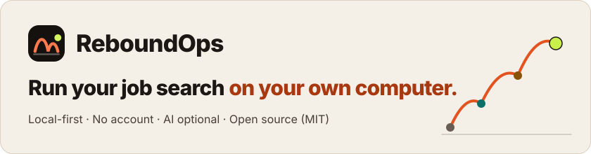
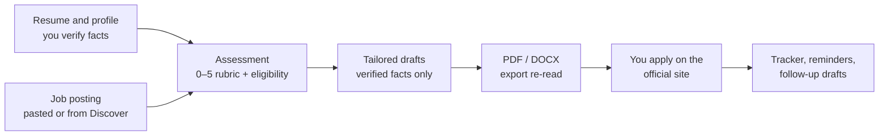

<p align="center">
  <picture>
    <source media="(prefers-color-scheme: dark)" srcset="docs/assets/brand/readme-banner-dark.svg">
    
  </picture>
</p>

<p align="center">
  <a href="LICENSE"></a>
  <a href="https://github.com/AnkitParekh007/rebound-ops/releases/tag/v0.2.0"></a>
  <a href="https://github.com/AnkitParekh007/rebound-ops/actions/workflows/ci.yml?query=branch%3Amain"></a>
  
</p>

# ReboundOps

**An open-source, local-first job search assistant.** Capture postings, see where every detail came from, assess fit honestly, tailor your resume and cover letter from facts you have verified, and track applications and follow-ups. Everything runs on your own computer. There is no account, and AI is optional.

> **Status: [v0.2.0 is published as a pre-release](https://github.com/AnkitParekh007/rebound-ops/releases/tag/v0.2.0)** (tag `v0.2.0`, built by CI, with SBOM, third-party notices and `SHA256SUMS`). It is early software. Read the [known limitations](#known-limitations) before relying on it.

## Why ReboundOps

Job searching produces a lot of scattered, personal data: postings, tailored resumes, screening answers, recruiter notes and dates. Most tools ask you to upload all of it to someone else's server, and many AI tools will happily invent experience you do not have. ReboundOps takes the opposite approach.

- **Your data stays on your machine.** One SQLite database in a private folder (`0700`/`0600`). There is no account, no telemetry and no cloud service.
- **Nothing is invented.** Drafts use only facts you have marked as verified. Missing information stays blank or becomes a visible `[[placeholder]]`, and AI suggestions that add facts are withheld.
- **Scores you can explain.** Fit is a transparent 0–5 rubric (`fit-2026.2`) that shows its evidence. Eligibility is reported separately as *confirmed*, *unconfirmed* or *ineligible*, and missing information is kept apart from real disqualifiers.
- **You stay in control.** ReboundOps never submits an application or sends a message. *Applied* is only ever set by you.
- **It works fully without AI.** Local AI through Ollama, or one of four cloud providers, is opt-in. Cloud requests need your consent.

## Screenshots

Screenshots are not in the repository yet. They will be captured from the app running on **fictional fixture data only** (for example `tests/fixtures/resumes/jordan-fictional.txt`), saved under `docs/assets/screenshots/`, and shown here in light and dark themes. Planned views: Overview, Job intake with evidence, Assessment, Documents, and Tracker. See [ROADMAP.md](ROADMAP.md).

## Features

| Area | What it does |
| --- | --- |
| Onboarding | Welcome flow with skip, back and next; choose local-only or optional AI mode; set your search goals |
| Profile | Preferences, eligibility facts, contact details and links, skills, verified experience with highlights, education, certifications and saved answers |
| Resume import | `.pdf` (selectable text, read locally), `.docx`, `.txt`, `.md` or pasted text. Extraction confidence and warnings are shown. Scanned, protected or damaged PDFs are detected, and the original file is kept. You review facts before they are added; nothing is overwritten |
| Discover | Look up one company's public job board on **Greenhouse, Lever, Ashby or Workable**, after you consent to the network request. Workday has no documented public API and is not supported |
| Job intake | Paste a description and URL. Title, employer, location, salary (only when stated) and work arrangement are shown with the text they came from. Duplicates are detected. Postings stay *unverified* until you confirm them |
| Assessment | Explainable 0–5 fit rubric: role, required skills, experience (including per-skill years), location, seniority and published pay. Shows confidence, adjustable weights, and eligibility (confirmed, unconfirmed or ineligible) |
| Documents | Tailored resume and cover letter, editable, with provenance. ATS-friendly **PDF and DOCX** exports are re-read to confirm that employers, dates, education and links survived |
| Preparation | Screening answers drafted only from saved answers and stated facts (otherwise marked "needs your answer"), a checklist, and the official application link when it is known |
| Tracking | Status workflow from Discovered to Offer, with an activity trail. Closed applications reopen with their history, and the original submission date is kept. Contacts and reminders have 30-day undo. Also interview notes, follow-up drafts and your own templates (never sent automatically), and CSV export |
| Overview | Pipeline, next actions, ranked follow-ups, reminders, response rate and median days to response, all derived from your saved records |
| Data | Full database backup, optionally password-protected (AES-256-GCM with scrypt). Crash-safe restore in the app or from the command line, readable JSON and CSV exports, and a staged, previewed [import format](docs/IMPORT_FORMAT.md) |

## How it works



1. **Set up your profile.** Import a resume and confirm each fact. Unconfirmed facts are never used in drafts.
2. **Add a job.** Paste a posting, or look up a company's public board in Discover.
3. **Assess it.** Read the fit score, the evidence behind it, and what is missing.
4. **Prepare.** Edit the tailored resume, cover letter and screening answers, then export PDF or DOCX.
5. **Apply yourself.** Use the official link, then confirm *Applied* in the tracker.
6. **Follow up.** Reminders and follow-up drafts help you keep track; you send everything yourself.

## Install in about a minute

You need **Node.js 24 or newer** and npm 11 (bundled with Node 24).

**From the v0.2.0 release archive** (recommended):

1. Download `reboundops-0.2.0.tar.gz` and `SHA256SUMS` from the [v0.2.0 release](https://github.com/AnkitParekh007/rebound-ops/releases/tag/v0.2.0).
2. Run:

```bash
shasum -a 256 -c SHA256SUMS --ignore-missing
tar -xzf reboundops-0.2.0.tar.gz
cd reboundops-0.2.0
npm ci --omit=dev --omit=optional --ignore-scripts
npm start
```

Then open <http://127.0.0.1:4175>. Stop with `Ctrl+C`. Your data is stored in `~/.reboundops` unless you set `REBOUND_DATA_DIR`. To upgrade from v0.1.0, back up first and start v0.2.0 on the same data folder: see [docs/INSTALL.md](docs/INSTALL.md).

**From source:**

```bash
git clone https://github.com/AnkitParekh007/rebound-ops.git
cd rebound-ops
npm ci
npm run build
npm start
```

## Platforms and prerequisites

| Platform | Status |
| --- | --- |
| macOS on Apple Silicon | Primary target; verified on the development machine |
| macOS on Intel | Expected to work; not separately tested |
| Linux (x64) | Tested in CI on Ubuntu 24.04, including the browser journey |
| Windows 11 | **Not tested.** It may work because it is Node-only; file-permission hardening is best effort |

The interface is a browser tab on `127.0.0.1`; there is no desktop wrapper. It needs about 100 MB of disk space and about 105 MB of memory (measured on Apple Silicon). The network is used to install the runtime libraries, and afterwards only if you use Discover or a cloud AI provider. Full details are in [docs/INSTALL.md](docs/INSTALL.md).

## Privacy and AI choices

| Mode | What leaves your computer |
| --- | --- |
| **Local only** (default) | Nothing. Every feature works. |
| **Discover** | After you allow it, a request to the job board's public endpoint containing only the board name you typed. HTTPS allow-listed hosts only, no cookies, one request per second per host, and `Retry-After` is respected. |
| **Ollama** (optional) | Nothing leaves the machine. Requests go to your local Ollama. |
| **Cloud AI** (opt-in: Anthropic, OpenAI, Gemini or OpenRouter) | Only the text a task needs (verified profile entries only), and only after you consent to that request. Keys are read from environment variables and never stored or displayed. These providers are tested with mocked requests only. |

AI only *suggests*: rewording, summaries, missing skills, interview questions and drafts. Each suggestion is checked against your records and withheld if it adds facts, and nothing is saved automatically.

## Architecture and stack

An npm workspaces monorepo in TypeScript: an **Angular** UI (standalone components, signals, zoneless) and a **Fastify** API bound to loopback, with persistence in Node's built-in `node:sqlite`. Shared **zod** schemas define the API contract. Business logic lives in framework-free packages.

```
apps/api                   Fastify server on loopback (guards, validation, same-origin web serving)
apps/web                   Angular UI
packages/contracts         Shared zod schemas: the API contract
packages/core              Workflow rules, dashboard and analytics
packages/job-intelligence  Extraction with evidence, dedupe, grounding, fit and eligibility
packages/documents         Resume import, tailoring, cover letters, PDF/DOCX writers, export checks
packages/applications      Screening answers, checklist, follow-up drafts
packages/ai-providers      Optional Ollama / Anthropic / OpenAI / Gemini / OpenRouter adapters, grounded tasks
packages/job-sources       Public job-board adapters (Greenhouse, Lever, Ashby, Workable), polite HTTP client
packages/importer          Import planning (validation, dedupe, no-overwrite profile merge)
packages/storage           SQLite persistence, append-only migrations, crash-safe restore, encrypted backups
scripts/                   Smoke, export verification, release audit and packaging
tests/                     Fictional fixtures, integration and end-to-end tests
```

There is more detail in [docs/ARCHITECTURE.md](docs/ARCHITECTURE.md).

### Security

- The server binds to loopback and answers only to loopback host names (a DNS-rebinding defence). It rejects unknown `Origin`s, requires JSON for writes, and limits body sizes.
- Job descriptions and imported files are untrusted input. They are validated, stored and shown as plain text, and AI prompts pass them as quoted data.
- The web app ships a strict Content-Security-Policy and loads nothing remote.
- To report a vulnerability, see [SECURITY.md](SECURITY.md). Please do not open a public issue.

### Configuration

| Variable | Default | Purpose |
| --- | --- | --- |
| `REBOUND_DATA_DIR` | `~/.reboundops` | Where the database lives |
| `REBOUND_API_PORT` | `4175` | Port |
| `REBOUND_API_HOST` | `127.0.0.1` | Must be a loopback address |
| `REBOUND_WEB_DIST` | built app if present | Directory of the web build to serve; an empty string disables it |
| `REBOUND_ALLOWED_ORIGINS` | dev server and own origin | Exact-match CORS allow-list |
| `REBOUND_LOG_LEVEL` | `warn` | Log level; request bodies and URLs are never logged |
| `ANTHROPIC_API_KEY`, `OPENAI_API_KEY`, `GEMINI_API_KEY`, `OPENROUTER_API_KEY` | unset | Only needed if you enable that cloud provider |

## Known limitations

- Discover covers one company board at a time; no cross-company search. Workday is not supported.
- The Workable integration uses the public feed behind Workable-hosted careers pages, not Workable's authenticated API, so it could change without notice.
- PDF import reads selectable text only. There is no OCR, and multi-column layouts may merge lines (a warning is shown).
- Cloud AI providers are tested with mocked requests only.
- Windows is untested, and Intel macOS is not separately tested.
- Automatic migration from earlier, non-ReboundOps tools is not included; no real legacy data has been migrated. See [docs/MIGRATION_SPEC.md](docs/MIGRATION_SPEC.md).

## Contributing

Contributions are welcome, especially platform testing, accessibility and documentation. Start with [CONTRIBUTING.md](CONTRIBUTING.md); it has the exact setup and test commands. Please follow the [Code of Conduct](CODE_OF_CONDUCT.md), and use only fictional data in issues, tests and screenshots.

```bash
npm ci
npm run lint && npm run typecheck && npm test
```

## Roadmap

[ROADMAP.md](ROADMAP.md) lists what is planned next and what is not planned, drawn from the documented limitations. Release history is in [CHANGELOG.md](CHANGELOG.md).

## Documentation

| Document | Contents |
| --- | --- |
| [docs/INSTALL.md](docs/INSTALL.md) | Install, upgrade, backups and restore, and building a release |
| [docs/ARCHITECTURE.md](docs/ARCHITECTURE.md) | How the packages fit together |
| [docs/RELEASE_READINESS.md](docs/RELEASE_READINESS.md) | Verification evidence and known gaps for each release |
| [docs/IMPORT_FORMAT.md](docs/IMPORT_FORMAT.md) | The neutral import format |
| [docs/MIGRATION_SPEC.md](docs/MIGRATION_SPEC.md) and [docs/LEGACY_EXPORT_PROCEDURE.md](docs/LEGACY_EXPORT_PROCEDURE.md) | Moving data from an earlier version |
| [docs/PROVENANCE.md](docs/PROVENANCE.md) | Originality and licensing notes |

The full script reference is in [CONTRIBUTING.md](CONTRIBUTING.md#scripts).

## Support

Questions, bug reports and ideas go through the channels in [SUPPORT.md](SUPPORT.md). ReboundOps is maintained by one person in their own time, and there is no paid support.

## Licence

[MIT](LICENSE) © 2026 Ankit Parekh. Third-party packages keep their own licences. Release archives include `THIRD_PARTY_NOTICES.txt` and an SBOM, and the web build includes `3rdpartylicenses.txt`.
