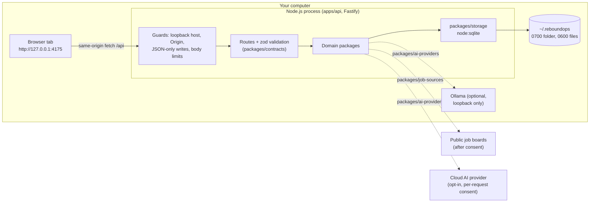
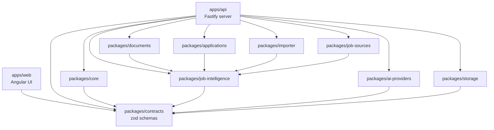

# Architecture

ReboundOps is one Node.js process on your computer. It serves an Angular single-page app and a JSON API from `127.0.0.1`, and it keeps everything in one SQLite database in a private folder. This guide describes the repository at v0.2.0; the package list was read from each `package.json`.

## Runtime view

Dotted lines are optional, and each one needs the user's action or consent. With AI off and Discover unused, no request leaves the machine after installation.

### Desktop apps (`apps/desktop`)

The desktop apps run the same server. A small Tauri shell (Rust, using the operating system's own web view: WKWebView on macOS, WebView2 on Windows) replaces the browser tab:

1. It shows a bundled splash page, picks a free port on `127.0.0.1` and starts the bundled Node.js runtime with `server/main.mjs`. That file is the API and every `@reboundops` package bundled by `scripts/build-desktop-server.ts`; pdf.js is copied next to it because it loads its worker from its own folder.
2. It sets `REBOUND_PARENT_WATCH=stdin`, `REBOUND_API_PORT` and `REBOUND_WEB_DIST`. The data folder is the usual `~/.reboundops` unless `REBOUND_DATA_DIR` is set, so the desktop app and `npm start` share data, and the existing data-folder lock stops both running at once.
3. When `/api/health` answers, the window navigates to `http://127.0.0.1:<port>/`. The window may only show that origin and its own splash page. Other links, such as an employer's application page, open in the default browser, and only `http`, `https` and `mailto` links are passed on. Downloads go to the Downloads folder without overwriting.
4. On quit the shell closes the server's stdin, so the server closes the database and releases the lock. It forces the process to stop only if it is still running after 5 seconds.

The web content gets no access to Tauri APIs: there are no capabilities or commands. `REBOUND_DESKTOP_SMOKE=1` runs start, checks and a clean stop without a window; CI uses it to test the real app on each platform (`.github/workflows/desktop.yml`).

## Package dependencies

`apps/web` depends only on `packages/contracts`, and reaches everything else through the HTTP API. Domain packages never import Fastify, Angular or SQLite, so they can be tested on their own.

| Package | Responsibility | Notable third-party runtime dependency |
| --- | --- | --- |
| `apps/api` | Server start-up and configuration, guards, routes, static serving with CSP, restore, the discovery orchestration | `fastify`, `zod` |
| `apps/web` | Angular UI: standalone components, signals, zoneless | Angular, `rxjs` |
| `packages/contracts` | Shared zod schemas: the API contract and the import format | `zod` |
| `packages/core` | Workflow rules (status transitions, *Applied* needs confirmation), dashboard, analytics, follow-up ranking | none |
| `packages/job-intelligence` | Field extraction with evidence, deduplication, grounding checks, the fit rubric and eligibility | none |
| `packages/documents` | Resume import (PDF, DOCX, text), tailoring, cover letters, PDF and DOCX writers, export read-back | `pdfjs-dist` (PDF text reading) |
| `packages/applications` | Screening answers from saved facts, the checklist, follow-up drafts | none |
| `packages/job-sources` | Greenhouse, Lever, Ashby and Workable adapters, and a polite HTTP client (allow-list, rate limit, cache) | none |
| `packages/importer` | Import planning: validation, deduplication, no-overwrite profile merge | none |
| `packages/ai-providers` | Optional Ollama, Anthropic, OpenAI, Gemini and OpenRouter adapters, grounded assist tasks, consent checks | `@anthropic-ai/sdk` |
| `packages/storage` | SQLite persistence, append-only migrations, backups (optionally encrypted), crash-safe restore, data-folder lock | none (`node:sqlite` is built in) |

## Key flows

**Job intake → assessment.** The API validates the pasted text against a contract schema. `job-intelligence` extracts fields together with the source text that supports each one; anything unsupported stays empty. The posting is stored as *unverified*. Assessments are computed on demand from the stored posting and the verified profile, and are never stored, so a rubric change (`fit-2026.1` → `fit-2026.2`) takes effect immediately.

**Tailoring → export.** `documents` selects and orders only highlights the user has marked verified, and uses `[[placeholders]]` for gaps. Exports are written to PDF and DOCX, then read back to check that employers, dates, education and links survived.

**Discover.** After consent, `job-sources` calls one board's documented public endpoint. Requests go only to allow-listed HTTPS hosts, without cookies, at no more than one request per second per host, with a 15-second timeout, a 25 MB cap and a 30-minute cache. Results are labelled with the time the board last listed them.

**AI assist.** Each task sends only the fields it needs, and only verified profile entries. Its output is compared with the user's records, and any suggestion that introduces new facts is withheld. Nothing is saved without the user's action. Ollama must be on a loopback address.

**Backup and restore.** A backup is a full database snapshot, optionally encrypted with scrypt and AES-256-GCM. Restore stages and validates the backup, checks free disk space, writes a recovery copy, journals the swap, and rolls back automatically if it is interrupted.

## Build, test and release

- TypeScript runs natively on Node 24 or newer (type stripping); only the Angular app has a build step.
- Vitest covers packages, the API and integration tests; Angular tests include axe accessibility checks; Playwright runs the end-to-end journey.
- `scripts/` holds the smoke test, export verification, the release audit (paths, secrets, licences, SBOM, `npm audit`, CSP), and the reproducible packaging and verification scripts.
- CI (`.github/workflows/ci.yml`) runs the `verify` and `e2e` jobs on Ubuntu 24.04 with Node 24.
