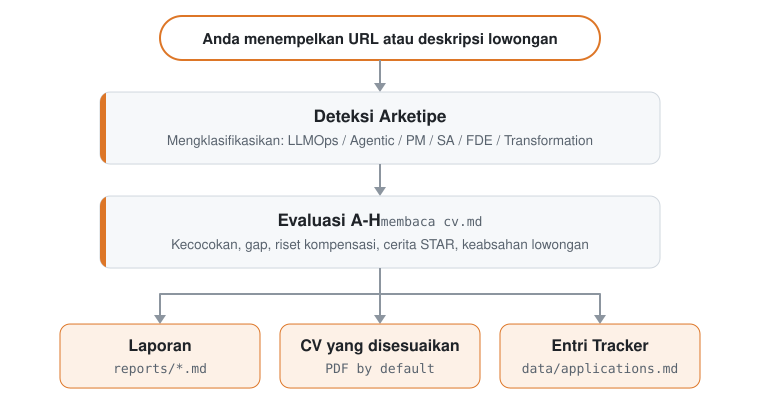

# ReboundOps engine

The job-search data folder and command-line scripts behind the **ReboundOps Workspace** (`../workspace`), part of the [rebound-ops](https://github.com/AnkitParekh007/rebound-ops) monorepo. Start the integrated demo from the repository root with `scripts/start-demo.sh`.

## Apa yang dilakukan rebound-ops untuk Anda

Tempel info lowongan. Alat ini memberi tahu apakah lowongan itu layak diperjuangkan malam ini.

- **Masih buka?** Mengecek apakah lowongan tersebut masih aktif sebelum Anda mulai menulis sepatah kata pun.
- **Kurang cocok?** Memberi skor kecocokan posisi terhadap CV asli Anda dan menyarankan untuk melewati lowongan yang kurang pas. Anda tetap bisa mengabaikan saran ini.
- **Layak dicoba?** Menyiapkan draf CV, *cover letter*, dan jawaban formulir lamaran. Anda yang membaca, Anda yang mengirim.
- **Siapa yang harus dihubungi?** Mencari orang yang tepat dan membuatkan draf pesannya. Alat ini tidak pernah mengirim pesan tersebut.
- **Ke mana larinya semua data?** Setiap lamaran tetap tersimpan di komputer Anda. Tidak ada satu pun yang diunggah ke tempat kami.
- **Apa yang perlu saya pelajari?** Setelah serangkaian penolakan, alat ini menunjukkan letak kekurangan (*skill gap*) Anda.

Percobaan awal mungkin terasa belum mulus karena sistem ini belum mengenal Anda. Ajak bicara: berikan CV Anda, beri tahu apa yang Anda incar dan apa yang Anda tolak. Anggap saja seperti minggu pertama seorang rekruter pribadi Anda.

Saat pertama kali dijalankan, semua itu akan ditanyakan langsung lewat obrolan (*chat*). Tidak ada yang perlu dikonfigurasi secara manual.

## Apa yang tidak akan dilakukan rebound-ops

- **Mengirim lamaran secara otomatis (*auto-submit*).** Alat ini membuatkan draf jawaban untuk setiap kolom; Anda yang meninjau dan menekan tombol Submit. Skripnya tidak pernah melakukan request POST (`prepare-application.mjs`).
- **Mengirim email.** Hanya sebatas draf. Tidak ada mekanisme pengiriman email sama sekali di dalam *codebase* ini.
- **Mengirim data diam-diam (*phone home*).** Tanpa telemetri, tanpa *backend* dari pihak kami. CV Anda hanya dikirim dari komputer Anda langsung ke penyedia AI yang Anda pilih, tidak ke tempat lain. Satu-satunya catatan publik adalah repositori ini: `HIRED.md` beserta *issue*-nya.
- **Mendorong Anda melamar di bawah skor 4.0/5.** Sistem akan menyarankan Anda untuk tidak melamar. Anda tetap bisa memilih untuk melanjutkannya, dan sistem akan mencatatnya demikian.

Alat ini menyusun ulang kalimat di CV Anda, tetapi pantang mengarang bebas. Pengecekan di dalam kode akan menghentikan pembuatan PDF apabila ada angka atau fakta yang tidak ditemukan baik di dalam CV maupun di ringkasan artikel (*article digest*) Anda. Meski begitu, sistem belum bisa menilai setiap perubahan gaya bahasa secara sempurna. Selalu baca kembali setiap CV sebelum Anda mengirimkannya. Detail selengkapnya ada di [FAQ](#faq).

## Fitur

| Fitur | Deskripsi |
| ------------------------ | ---------------------------------------------------------------------------------------------------------------------------------------- |
| **Evaluasi A-H** | Ringkasan peran, kecocokan CV (lengkap dengan seberapa penting tiap persyaratan untuk lowongan tersebut, serta label per persyaratan apakah bobot itu berasal dari kata-kata langsung di JD, strukturnya, atau sekadar estimasi; estimasi tidak pernah bisa masuk kategori teratas), strategi level, riset kompensasi, personalisasi, persiapan wawancara (STAR+R) -- ditambah pengecekan keabsahan lowongan pada Blok G (apakah masih buka, apakah hasil *repost*: berupa observasi, bukan vonis), dan sinyal izin kerja (*Work-Auth*) yang menandai pernyataan eksplisit dalam JD bahwa sponsor visa tidak tersedia sebagai penghalang mutlak (*hard blocker*) |
| **Human-in-the-Loop** | AI mengevaluasi dan memberi rekomendasi, Anda yang memutuskan dan bertindak. Sistem ini tidak pernah mengirim lamaran -- keputusan akhir selalu ada di tangan Anda <!-- hitl: absolute guarantee. Do not add "automatically", "by itself", "without your permission" or any other hedge when translating this row. --> |
| **Pembuatan PDF Ramah ATS** | CV yang mudah dibaca mesin ATS dan disesuaikan dengan setiap JD berdasarkan pengalaman asli Anda, menggunakan desain font Space Grotesk + DM Sans |
| **Generator Cover Letter** | *Cover letter* berbasis riset dengan pencocokan kata kunci (*keyword mirroring*), empat pilihan sudut pandang interaktif (alasan/masalah/pendekatan/nada bicara), tahap persetujuan draf di ruang *chat*, dan ekspor PDF ukuran A4 lewat *pipeline* HTML + Playwright yang sama dengan CV. Otomatis membuat draf di setiap evaluasi; lengkapi dan cetak kapan saja lewat `/rebound-ops cover` |
| **Lebih dari Sekadar CV** | Riset perusahaan ([`deep`](modes/deep.md)) menggali strategi AI, langkah bisnis terbaru, budaya *engineering*, dan sudut pandang yang sebaiknya ditonjolkan dari profil Anda. Pencarian kontak ([`contacto`](modes/contacto.md)) mengidentifikasi *hiring manager*, rekruter, atau rekan setim yang tepat untuk dihubungi sekaligus menyiapkan draf pesan LinkedIn ≤300 karakter yang disesuaikan dengan tipe kontaknya. Draf email lamaran formal ([`email`](modes/email.md)) mengubah laporan evaluasi atau teks JD menjadi baris subjek, isi email, dan daftar periksa lampiran tanpa mengirim, mengajukan, atau mengeklik apa pun. Lamaran memasukkan Anda ke dalam antrean; riset membuka peluang percakapan. |
| **Analisis Pola** | Pola penolakan dan rasio lolos per kanal ATS (`analyze-patterns.mjs`), statistik *funnel* keseluruhan (`stats.mjs`), serta deteksi *repost* yang bisa menjadi indikasi lowongan hantu / *ghost job* (`detect-reposts.mjs`) |

<details>
<summary><b>Semua kemampuan lainnya</b></summary>

| Fitur | Deskripsi |
| ------------------------ | ---------------------------------------------------------------------------------------------------------------------------------------- |
| **Auto-Pipeline** | Tempel URL, dapatkan evaluasi lengkap + PDF + entri di *tracker* |
| **Bank Cerita Wawancara** | Mengumpulkan cerita berformat STAR+Reflection dari berbagai evaluasi -- 5-10 cerita utama yang bisa Anda adaptasikan untuk menjawab pertanyaan *behavioral* |
| **Skrip Negosiasi** | Kerangka kerja negosiasi gaji, cara menanggapi potongan gaji berbasis lokasi geografis, serta pemanfaatan tawaran kerja lain (*competing offer*) |
| **Draf Email Lamaran** | Draf email lamaran formal untuk jalur rekruter, *referral*, maupun *cold email* dari laporan atau teks JD, lengkap dengan subjek, daftar periksa lampiran, poin kecocokan berbasis sumber asli, dan blok kontak dari profil Anda. Hanya berupa draf -- rebound-ops tidak pernah mengirim, mengajukan, atau mengeklik apa pun. |
| **Pemindai Portal** | Lebih dari 100 perusahaan sudah dikonfigurasi dari awal (Anthropic, OpenAI, ElevenLabs, Retool, n8n...) + kueri pencarian web kustom lintas Ashby, Greenhouse, Lever, Wellfound |
| **Penemuan Perusahaan yang Baru Mendapat Pendanaan** | Skrip `npm run company:funded` yang mengutamakan peninjauan (*review-first*) menampilkan perusahaan yang baru mendapat pendanaan beserta diagnostik sumber dari *feed* publik terstruktur tanpa mengubah data Anda |
| **Pemrosesan Batch** | Evaluasi paralel menggunakan *worker* CLI *headless* (`claude -p` / `opencode run`) |
| **Dashboard TUI** | Antarmuka terminal (TUI) untuk menjelajahi, memfilter, dan mengurutkan *pipeline* lamaran Anda |
| **Integritas Pipeline** | Penggabungan (*merge*) otomatis, penghapusan duplikat, normalisasi status, dan pemeriksaan kesehatan data |
| **Rangkaian Wawancara** | Rencana persiapan berbasis blok waktu, sesi latihan interaktif lengkap dengan umpan balik, evaluasi pasca-wawancara ([`interview/`](modes/interview/README.md)), serta pendeteksi tanda bahaya (*red-flag*) perusahaan ([`interview-redflag`](modes/interview-redflag.md)) |
| **Tahap Offer** | Pendamping pembacaan kontrak kerja -- membedah pasal demi pasal beserta daftar pertanyaan untuk dikonsultasikan ke pengacara ([`offer-prep`](modes/offer-prep.md)) -- dan penganalisis selisih gaji antara ekspektasi, iklan lowongan, dan tawaran aktual (`salary-gap.mjs`) |
| **Follow-up & Balasan** | Kalkulator ritme *follow-up* dan pengingat terjadwal (`followup-cadence.mjs`, `followup-seed.mjs`); dapat dinonaktifkan dengan mengatur `follow_ups.enabled: false` di `config/profile.yml`; klasifikasi balasan perusahaan untuk memperbarui *tracker* ([`reply-watch`](modes/reply-watch.md)) |
| **Sistem Plugin** | Integrasi opsional (Gmail, Notion, Apify + registri komunitas), nonaktif secara bawaan -- lihat [docs/PLUGINS.md](docs/PLUGINS.md) |

</details>

## Cara Kerjanya

<p align="center"><picture><source media="(prefers-color-scheme: dark)" srcset="docs/how-it-works-id-dark.svg"></picture></p>

## Mulai Cepat (Quick Start)

**Cara tercepat, cukup satu perintah:**

```bash
node engine/scaffolder/bin/cli.mjs init
```

> 💡 `npx` sudah sepaket dengan [Node.js](https://nodejs.org): perintah ini menjalankan *installer* satu kali tanpa perlu menginstal apa pun secara global. Belum punya Node? Instal terlebih dahulu.
> (Sudah memakai CLI Claude Code / Codex? Berarti Anda sudah memilikinya.)

Perintah di atas akan mengkloning rilis terbaru ke dalam folder `./rebound-ops` dan menginstal semua dependensi. Selanjutnya:

```bash
cd rebound-ops
claude   # atau codex / qwen / opencode / agy / grok — buka AI CLI Anda di direktori ini
```

**Saat pertama kali dijalankan, rebound-ops akan memandu proses penyiapan (CV, profil, dan target peran Anda) cukup lewat obrolan. Tidak ada file yang perlu diedit secara manual.**

<details>
<summary><b>Lebih suka menyiapkannya secara manual? (git clone)</b></summary>

```bash
git clone https://github.com/AnkitParekh007/rebound-ops.git
cd rebound-ops && npm install
npx playwright install chromium   # hanya diperlukan untuk pembuatan PDF
# Pada distro Linux selain Debian/Ubuntu (Fedora, Arch, ...), library sistem
# untuk Chromium tidak terinstal lewat perintah di atas — instal sendiri menggunakan
# package manager distro Anda jika pembuatan PDF gagal membuka browser
# (dokumentasi resmi Playwright mencantumkan daftar library yang dibutuhkan untuk tiap platform).

# 2. Buka AI CLI Anda di direktori ini. Saat pertama kali dijalankan, CLI akan
#    memandu penyiapan (CV, profil, dan target peran Anda) lewat obrolan
claude   # atau codex / opencode / qwen / agy / grok

# Lalu minta CLI Anda untuk menyesuaikan sistem dengan kebutuhan Anda:
# "Change the archetypes to backend engineering roles"
# "Translate the modes to English"
# "Add these 5 companies to portals.yml"
# "Update my profile with this CV I'm pasting"

# 3. Mulai gunakan
# Tempel URL lowongan atau teks JD untuk memicu auto-pipeline.
# Mode lainnya, dan cara memintanya di CLI Anda: lihat Penggunaan di bawah.
```

</details>

### Memindai melalui *outbound proxy*

Kalau Anda memindai dari *sandbox* yang hanya mengizinkan koneksi keluar lewat *proxy*, jalankan `REBOUND_OPS_TRUST_PROXY_EGRESS=1 node scan.mjs`. Aktifkan *flag* ini **hanya jika *proxy* yang Anda konfigurasi memang memblokir alamat privat, *loopback*, dan metadata**. Langkah lengkapnya (dalam bahasa Inggris) ada di [docs/SETUP.md](docs/SETUP.md#scanning-through-an-outbound-proxy).

### Instalasi global

```bash
npm i -g ./engine/scaffolder
```

Perintah ini menginstal *binary* `rebound-ops` secara global sehingga Anda bisa menjalankan `rebound-ops init [folder]` tanpa `npx`. `init` adalah satu-satunya perintahnya: ia menyiapkan *workspace*, dan semua langkah sesudahnya berlangsung di dalam AI coding CLI Anda (lihat Penggunaan di bawah), bukan melalui *binary* ini.

**Mana yang sebaiknya Anda gunakan?**
- `node engine/scaffolder/bin/cli.mjs init`: paling pas untuk penggunaan pertama kali; membuatkan folder proyek khusus.
- `npm i -g ./engine/scaffolder`: jika Anda lebih suka mengetik `rebound-ops init` daripada bentuk `npx`. Instalasi ini tidak menambahkan perintah lain.

### Cara lain untuk menjalankannya

- **Dari folder mana pun, sebagai plugin Claude Code:** [docs/CLAUDE_PLUGIN.md](docs/CLAUDE_PLUGIN.md).
- **Tanpa CLI AI:** skrip mandiri Gemini, Ollama, dan yang kompatibel dengan OpenAI dapat mengevaluasi deskripsi pekerjaan secara mandiri. Lihat [docs/SCRIPTS.md](docs/SCRIPTS.md#geminieval--ollamaeval--openaieval).

> **Sistem ini dirancang agar bisa dikustomisasi langsung oleh AI coding CLI Anda.** Mode, arketipe peran, bobot penilaian, hingga skrip negosiasi -- cukup minta AI CLI Anda untuk mengubahnya. Karena ia membaca file yang sama dengan yang ia gunakan, ia tahu persis bagian mana yang harus diedit.

Lihat [docs/SETUP.md](docs/SETUP.md) untuk panduan penyiapan lengkap (termasuk [memindai melalui *outbound proxy*](docs/SETUP.md#scanning-through-an-outbound-proxy)), [docs/SUPPORTED_CLIS.md](docs/SUPPORTED_CLIS.md) untuk cara menjalankan rebound-ops di setiap CLI yang didukung beserta perintah *headless*-nya bila ada, [docs/RUNNING_ON_A_BUDGET.md](docs/RUNNING_ON_A_BUDGET.md) untuk petunjuk menjalankan rebound-ops secara hemat memakai model kustom atau lokal (dan [docs/FREE_TIER.md](docs/FREE_TIER.md) untuk menjalankannya tanpa biaya di *free tier* Antigravity CLI), [docs/AUTOMATION.md](docs/AUTOMATION.md) untuk menjadwalkan pemindaian berkala dan resep penyaringan nol-token menjadi daftar incaran (*shortlist*), [docs/KEEPING_PORTALS_LIVE.md](docs/KEEPING_PORTALS_LIVE.md) untuk menjaga daftar perusahaan Anda tetap mutakhir, [docs/BACKUP_STRATEGIES.md](docs/BACKUP_STRATEGIES.md) untuk mencadangkan CV, tracker, dan laporan Anda, [docs/APPLY_AUTOFILL.md](docs/APPLY_AUTOFILL.md) untuk detail alur pengisian formulir ATS otomatis, [docs/LINKEDIN_JOIN.md](docs/LINKEDIN_JOIN.md) untuk mencocokkan ekspor koneksi LinkedIn dengan daftar perusahaan di *funnel* Anda, dan [docs/FAQ.md](docs/FAQ.md) untuk jawaban atas pertanyaan umum seputar penyiapan, termasuk [bagaimana pelacakan sumber cerita (*story provenance*) mencegah munculnya angka karangan](docs/FAQ.md#why-does-rebound-ops-refuse-to-use-a-number-from-my-story-bank). Prinsip desain ada di [ARCHITECTURE.md](ARCHITECTURE.md); alur *runtime* ada di [docs/ARCHITECTURE.md](docs/ARCHITECTURE.md).

## Penggunaan

Tempelkan URL atau deskripsi lowongan ke CLI AI Anda. rebound-ops memeriksa apakah lowongan yang ditautkan masih aktif (teks yang ditempel tidak memiliki tautan untuk diperiksa), menilainya terhadap CV Anda, menulis laporan, menyesuaikan CV Anda (PDF secara bawaan), dan menambahkan satu baris ke tracker Anda. Itu saja sudah mencakup sebagian besar kebutuhan harian Anda. Sisanya adalah mode yang Anda minta dengan menyebut namanya. Jika sebuah lowongan tidak dapat dibaca, pipeline berhenti dan meminta Anda menempelkan teksnya.

### Cara meminta sebuah mode

| CLI | Cara meminta `scan` |
| --- | --- |
| Claude Code, OpenCode, Antigravity CLI (`agy`), Grok Build CLI | `/rebound-ops scan` |
| Pi | `/skill:rebound-ops scan` |
| Codex, Qwen, Cursor, atau CLI lain yang didukung | Bahasa biasa: "Run the rebound-ops scan mode" |

`/rebound-ops` tanpa tambahan apa pun menampilkan menu perintah di CLI yang memakainya. Bahasa biasa berfungsi di semua CLI yang didukung. Sebagai plugin Claude Code, perintahnya adalah `/rebound-ops:rebound-ops`.

Semuanya memakai satu router yang sama, `.agents/skills/rebound-ops/SKILL.md`, dan berkas `modes/*.md` yang sama, sehingga sebuah mode berperilaku sama di CLI mana pun. Perintah slash tidak dijamin di Codex: minta dengan bahasa biasa, atau jalankan satu prompt secara headless dengan `codex exec "Evaluate this JD with rebound-ops auto-pipeline: https://company.com/jobs/123"` ([docs/CODEX.md](docs/CODEX.md)). Cara menjalankannya di setiap CLI yang didukung, perintah headless untuk CLI yang memilikinya, dan catatan penyiapan per CLI ada di [docs/SUPPORTED_CLIS.md](docs/SUPPORTED_CLIS.md).

### Perintah sehari-hari

| Perintah | Fungsinya |
| --- | --- |
| *tempel URL atau deskripsi lowongan* | Pipeline lengkap: cek apakah lowongan masih aktif (khusus URL), evaluasi A-G ditambah H pada skor tinggi, laporan, CV yang disesuaikan (PDF secara bawaan), baris tracker |
| `scan` | Memindai portal Anda untuk mencari lowongan baru dan menambahkannya ke kotak masuk (`data/pipeline.md`) |
| `pipeline` | Mengevaluasi setiap URL yang menunggu di kotak masuk |
| `apply` | Mengisi formulir lamaran bersama Anda, kolom demi kolom. Berhenti sebelum tombol Kirim |
| `tracker` | Posisi setiap lamaran saat ini |
| `followup` | Lamaran mana saja yang sudah waktunya ditindaklanjuti, lengkap dengan drafnya |

<details>
<summary><b>Semua perintah, menurut tahap pencarian</b></summary>

`oferta`, `ofertas`, dan `contacto` tetap memakai nama asli bahasa Spanyol: tawaran, beberapa tawaran, kontak.

**Cari posisi**

| Perintah | Fungsinya |
| --- | --- |
| [`scan`](modes/scan.md) | Memindai portal dan menemukan lowongan baru |
| [`discover`](modes/discover.md) | Mengubah daftar nama perusahaan menjadi board ATS yang dapat dipindai dan menambahkannya ke `portals.yml` (nol token) |
| [`pipeline`](modes/pipeline.md) | Memproses URL yang tertunda di kotak masuk (`data/pipeline.md`) |
| [`triage`](modes/triage.md) | Penilaian cepat tahap pertama (lolos atau tidak) dari `modes/_brief.md`, sebelum evaluasi penuh (tidak menulis berkas apa pun) |
| [`batch`](modes/batch.md) | Mengevaluasi banyak lowongan dengan worker headless paralel |
| [`titles`](modes/titles.md) | Menyarankan jabatan yang berdekatan dari CV Anda untuk memperluas pencarian |

**Evaluasi sebuah posisi**

| Perintah | Fungsinya |
| --- | --- |
| *tempel URL atau deskripsi lowongan* | [Auto-pipeline](modes/auto-pipeline.md): evaluasi + laporan + CV yang disesuaikan (PDF secara bawaan) + entri tracker |
| [`oferta`](modes/oferta.md) | Evaluasi saja, blok A sampai G ditambah H pada skor tinggi (tanpa PDF) |
| [`ofertas`](modes/ofertas.md) | Membandingkan dan memeringkat beberapa tawaran |
| [`deep`](modes/deep.md) | Prompt riset mendalam tentang perusahaan |
| [`eu-swe`](modes/regional/eu-swe.md) | Mengkalibrasi lamaran rekayasa perangkat lunak untuk Eropa sebelum tahap CV, melamar, atau wawancara |

**Melamar**

| Perintah | Fungsinya |
| --- | --- |
| [`pdf`](modes/pdf.md) | CV yang dioptimalkan untuk ATS dalam bentuk PDF |
| [`ats`](modes/ats.md) | Pemeriksaan kesesuaian ATS pada CV yang dihasilkan: skor dan masalah yang dapat diperbaiki |
| [`text`](modes/text.md) | CV yang disesuaikan dalam markdown (mencerminkan `cv.md`, tanpa PDF) |
| [`latex`](modes/latex.md) | Mengekspor CV sebagai `.tex` LaTeX/Overleaf |
| [`latex-tex`](modes/latex-tex.md) | Menyesuaikan `resume.tex` Anda sendiri di tempat (opsional; `cv.md` tetap menjadi bawaan) |
| [`cover`](modes/cover.md) | Surat lamaran, dari deskripsi pekerjaan yang ditempel atau laporan yang sudah dievaluasi (`cover {slug}`) |
| [`email`](modes/email.md) | Draf email lamaran formal. Hanya draf: tidak pernah mengirim, menyerahkan formulir, atau mengeklik apa pun |
| [`contacto`](modes/contacto.md) | Mencari hiring manager, rekruter, atau rekan sejawat, lalu membuat draf pesan LinkedIn |
| [`apply`](modes/apply.md) | Asisten lamaran langsung (Playwright dari checkout ini). Tidak mengirim lamaran |

**Wawancara**

| Perintah | Fungsinya |
| --- | --- |
| [`interview-prep`](modes/interview-prep.md) | Dokumen persiapan wawancara khusus perusahaan |
| [`interview/plan`](modes/interview/plan.md) | Rencana persiapan berbasis blok waktu untuk wawancara yang akan datang |
| [`interview/practice`](modes/interview/practice.md) | Latihan wawancara, satu pertanyaan setiap kalinya, dengan umpan balik |
| [`interview/debrief`](modes/interview/debrief.md) | Ulasan setelah wawancara: menutup celah, memperkirakan putaran berikutnya |
| [`interview-redflag`](modes/interview-redflag.md) | Menganalisis tanda-tanda peringatan dari pemberi kerja sebelum Anda bergabung |

**Setelah melamar**

| Perintah | Fungsinya |
| --- | --- |
| [`tracker`](modes/tracker.md) | Ringkasan status seluruh lamaran |
| [`followup`](modes/followup.md) | Jadwal tindak lanjut: menandai lamaran yang lewat tenggat, membuatkan draf |
| [`reply-watch`](modes/reply-watch.md) | Mengklasifikasikan balasan pemberi kerja dan menyarankan pembaruan tracker |
| [`outcome`](modes/outcome.md) | Mencatat hasil sebuah lamaran dan mengarsipkan artefaknya |
| [`offer-prep`](modes/offer-prep.md) | Membaca tawaran atau kontrak yang Anda terima bersama Anda: menelusuri klausul satu per satu dan menyusun pertanyaan untuk pengacara (bukan nasihat hukum) |

**Profil dan CV Anda**

| Perintah | Fungsinya |
| --- | --- |
| [`interview`](modes/interview.md) | Penyiapan profil: wawancara interaktif tentang pengalaman Anda yang membangun CV dan profil Anda (bukan latihan wawancara) |
| [`intake`](modes/intake.md) | Membangun atau memperkaya profil Anda dari berkas di `documents/` (CV induk, ekspor LinkedIn). Tidak ada yang ditulis tanpa konfirmasi Anda |
| [`master-profile`](modes/master-profile.md) | Mengimpor, meninjau, dan memvalidasi Master Career Profile Anda, lalu menyiapkan fakta terpilih sebagai poin CV |
| [`add`](modes/add.md) | Menambahkan proyek, makalah, atau peran ke CV Anda (ambil data, pratinjau, konfirmasi) |
| [`expand`](modes/expand.md) | Menemukan kompetensi yang belum ada di CV Anda dari tautan profil Anda |
| [`retro`](modes/retro.md) | Meninjau sesi ini dan menyimpan apa yang Anda ajarkan sebagai aturan (hanya menulis yang Anda terima) |

**Pertajam target Anda**

| Perintah | Fungsinya |
| --- | --- |
| [`patterns`](modes/patterns.md) | Menganalisis pola penolakan dan mempertajam target |
| [`calibrate`](modes/calibrate.md) | Memeriksa apakah skor evaluasi Anda memprediksi hasil nyata. Bersifat saran: tidak pernah mengubah penilaian |
| [`upskill`](modes/upskill.md) | Analisis kesenjangan keterampilan dari seluruh laporan Anda yang sudah dievaluasi |
| [`training`](modes/training.md) | Mengevaluasi kursus atau sertifikasi terhadap North Star Anda |
| [`project`](modes/project.md) | Mengevaluasi ide proyek portofolio |

**Sistem**

| Perintah | Fungsinya |
| --- | --- |
| [`agent-inbox`](modes/agent-inbox.md) | Mengantrikan permintaan untuk sesi berikutnya, lalu mengerjakannya pada sesi itu (`data/agent-inbox.md`). `inbox` juga bisa |
| [`update`](modes/update.md) | Memperbarui berkas sistem rebound-ops, dengan pratinjau diff dan pemeriksaan kompatibilitas |

</details>

## Portal yang Sudah Dikonfigurasi

Pemindai lowongan hadir dengan **100+ perusahaan** yang siap dipindai dan **35+ kueri pencarian** di berbagai portal kerja utama. Salin `templates/portals.example.yml` ke `portals.yml` dan tambahkan daftar incaran Anda sendiri:

**AI Labs:** Anthropic, OpenAI, Mistral, Cohere, LangChain, Pinecone
**Voice AI:** ElevenLabs, PolyAI, Parloa, Hume AI, Deepgram, Vapi, Bland AI
**AI Platforms:** Retool, Airtable, Vercel, Temporal, Glean, Arize AI
**Contact Center:** Ada, LivePerson, Sierra, Decagon, Talkdesk, Genesys
**Enterprise:** Salesforce, Twilio, Gong, Dialpad
**LLMOps:** Langfuse, Weights & Biases, Lindy, Cognigy, Speechmatics
**Automation:** n8n, Zapier, Make.com
**European:** Factorial, Attio, Tinybird, Clarity AI, Travelperk

**Portal lowongan kerja yang dicari:** Lebih dari 55 modul penyedia layanan mencakup API ATS, *feed* papan lowongan menyeluruh, *feed* XML/RSS, *feed* Markdown, serta *parser* lokal. Lihat [Portal kerja yang didukung](docs/SUPPORTED_JOB_BOARDS.md) untuk tabel selengkapnya.

Jaga daftarnya tetap mutakhir: `portals.yml` dirancang untuk terus hidup dan berkembang, bukan sekadar file yang diatur satu kali di awal. Lihat [Menjaga portals.yml tetap mutakhir](docs/KEEPING_PORTALS_LIVE.md) untuk aturan praktis yang menambahkan perusahaan baru secara otomatis serta perintah untuk memvalidasi file setiap kali ada perubahan.

Secara bawaan, `node scan.mjs` (atau `npm run scan`) mempercayai apa pun yang dikembalikan oleh masing-masing *feed* ATS. Beberapa perusahaan terkadang membiarkan lowongan lama tetap berada di API publik mereka meskipun posisinya sudah ditutup, sehingga lowongan kedaluwarsa tersebut bisa bocor ke dalam `pipeline.md`. Tambahkan *flag* `--verify` untuk menjalankan Playwright setelah pemindaian API selesai dan membuang lowongan yang sudah kedaluwarsa sebelum masuk ke *pipeline*:

```bash
node scan.mjs --verify          # penemuan nol-token + pengecekan keaktifan via Playwright
```

Proses verifikasi ini berjalan secara berurutan dan hanya memeriksa lowongan baru (setelah penghapusan duplikat), sehingga beban kerjanya tetap terkendali.

## Dashboard TUI

*Dashboard* terminal bawaan memudahkan Anda menjelajahi *pipeline* lamaran secara visual:

```bash
npm run serve:dashboard   # jalankan TUI
npm run build:dashboard   # opsional: build binary mandiri (standalone)
```

Fitur: 10 tab filter, 8 mode pengurutan, tampilan berkelompok/rata (*grouped/flat*), pratinjau *lazy-load*, serta pengubahan status langsung dari daftar (*inline*).

Tersedia juga **UI web eksperimental** (masih berstatus *alpha* dan bersifat *opt-in*: tidak ada yang berjalan kecuali Anda menyalakannya sendiri): lihat [`web/README.md`](web/README.md).

## Struktur Proyek

```
rebound-ops/
├── AGENTS.md                    # Instruksi agen utama (untuk semua CLI)
├── CLAUDE.md                    # Wrapper Claude Code (mengimpor AGENTS.md)
├── CODEX.md                     # Wrapper Codex (mengimpor AGENTS.md)
├── OPENCODE.md                  # Wrapper OpenCode (mengimpor AGENTS.md)
├── GEMINI.md                    # Pelindung no-op legacy untuk mencegah duplikasi konteks di Antigravity
├── cv.md                        # CV Anda (buat file ini)
├── article-digest.md            # Bukti pencapaian detail / proof points Anda (opsional)
├── config/
│   └── profile.example.yml      # Template untuk profil Anda
├── modes/                       # Mode-mode skill
│   ├── _shared.md               # Konteks bersama (kustomisasi bagian ini)
│   ├── oferta.md                # Evaluasi tunggal
│   ├── pdf.md                   # Pembuatan PDF
│   ├── cover.md                 # Pembuatan cover letter
│   ├── email.md                 # Draf email lamaran formal
│   ├── scan.md                  # Pemindai portal lowongan
│   ├── batch.md                 # Pemrosesan batch
│   └── ...
├── templates/
│   ├── cv-template.html         # Template CV yang dioptimalkan untuk ATS
│   ├── portals.example.yml      # Template konfigurasi pemindai
│   └── states.yml               # Daftar status kanonis
├── batch/
│   ├── batch-prompt.md          # Prompt worker mandiri (self-contained)
│   └── batch-runner.sh          # Skrip orkestrator batch
├── dashboard/                   # Penampil pipeline TUI berbasis Go
├── data/                        # Data pelacakan Anda (diabaikan oleh git / gitignored)
├── reports/                     # Laporan hasil evaluasi (gitignored)
├── output/                      # Hasil cetakan PDF (gitignored)
├── fonts/                       # Font Space Grotesk + DM Sans
├── docs/                        # Dokumentasi instalasi, kustomisasi, panduan hemat biaya, arsitektur
└── examples/                    # Contoh CV, laporan evaluasi, dan proof points
```

## Direktori Data Eksternal (Opsional)

Secara bawaan, data lapisan pengguna (seperti `cv.md`, `portals.yml`, serta folder `data/` / `reports/` / `output/`) disimpan di dalam folder *root* proyek.

Untuk memisahkan data pribadi Anda dari kode program (sehingga lebih mudah saat berpindah *branch*, menarik pembaruan/*pull updates*, atau menguji beberapa profil berbeda), Anda dapat mengonfigurasi direktori data eksternal dengan urutan prioritas berikut:

1. **Environment Variable:** Atur variabel `REBOUND_OPS_ROOT` atau `REBOUND_OPS_DATA_DIR`:
   ```bash
   export REBOUND_OPS_ROOT=~/my-career-data
   ```
2. **File Penanda (*Marker File*):** Buat file bernama `.rebound-ops-data` di *root* repositori yang berisi *path* menuju direktori data Anda.
3. **Bawaan (*Default*):** Kembali menggunakan *root* repositori.

Setelah lokasi ditentukan, semua file pengguna akan dibaca dan ditulis secara relatif terhadap folder tersebut, sementara file *prompt* dan skrip tetap mengacu pada folder repositori.

- **Override Tracker:** Anda juga bisa mengatur `REBOUND_OPS_TRACKER` untuk mengubah lokasi file *tracker* lamaran secara langsung.
- **Operasi Tulis:** Semua operasi penulisan (seperti penggabungan data/*merge*) secara baku diarahkan ke `{DATA_ROOT}/data/applications.md`.
- **Konfigurasi Pemindai:** `portals.yml` dibaca dan divalidasi di `{DATA_ROOT}/portals.yml`, sehingga `node validate-portals.mjs` memeriksa file yang sama persis dengan yang dibaca oleh `scan.mjs`.
- **Dokumen yang Dihasilkan:** CV dan *cover letter* yang telah disesuaikan ditulis ke dalam `{DATA_ROOT}/output/`, sedangkan manifes PDF yang menghubungkannya dengan laporan evaluasi tersimpan di `{DATA_ROOT}/data/pdf-index.tsv`. Selama `REBOUND_OPS_TRACKER` tidak diatur, *workspace tracker* yang membatasi area penulisan file-file tersebut adalah *data root*, bukan folder kode repositori.
- **PDF di bawah Override Tracker:** `generate-pdf.mjs` memeriksa `REBOUND_OPS_TRACKER` terlebih dahulu sebelum menentukan *workspace*. Jadi ketika *override* diaktifkan, *workspace*-nya adalah folder tempat *tracker* tersebut berada (atau satu folder di atasnya apabila *tracker* berada di dalam folder `data/`). File HTML CV beserta seluruh PDF harus berada di dalam *workspace* tersebut, dan lokasi manifesnya berpindah ke `data/pdf-index.tsv` di *workspace* itu. *Cover letter* tetap menargetkan `{DATA_ROOT}/output/`, sehingga pembuatannya akan ditolak apabila folder tersebut berada di luar *workspace tracker*.
- **Lapisan Kode Tetap di Tempatnya:** `node_modules/`, `providers/`, `modes/`, dan skrip-skripnya sendiri selalu mengacu pada repositori, tidak pernah berpindah ke *data root*.

Dashboard TUI Go, skrip Node.js, dan semua mode agen AI secara otomatis mematuhi hierarki penentuan lokasi ini.


## Tech Stack


- **Agen**: AI coding CLI dengan *skill* dan mode bersama (`AGENTS.md` + *wrapper* CLI)
- **PDF**: Playwright + *template* HTML
- **Cover letter**: *Template* HTML + Playwright (PDF ukuran A4, *pipeline* yang sama dengan CV)
- **Pemindai**: Playwright + Greenhouse API + WebSearch
- **Dashboard**: Go + Bubble Tea + Lipgloss (tema Catppuccin Mocha)
- **Data**: Tabel Markdown + konfigurasi YAML + file *batch* TSV

<p align="center">
</p>

<p align="center">
  <a href="https://claude.com/claude-code"></a>
</p>

<p align="center">
  <sub>Juga dapat berjalan di CLI mana pun yang mendukung standar agent-skill. Lihat <a href="docs/SUPPORTED_CLIS.md">CLI yang Didukung</a>.</sub><br>
  
  
  
  
  
  
  
  
  
  <br>
  
  
  
  
  
  <a href="TRADEMARK.md"></a>
</p>

## FAQ

**Apa itu rebound-ops?**
**Apakah CV yang disesuaikan bisa mengarang hal yang tidak nyata?**
Tidak boleh, dan *prompt*-nya secara tegas menginstruksikan demikian: susun ulang kalimatnya, jangan pernah mengarang bebas. Skrip `generate-pdf` akan memblokir pembuatan CV jika ada angka atau fakta yang tidak ditemukan di dalam sumber data Anda, kecuali jika Anda menyertakan *flag* `--skip-fact-check`. Mode `pdf` juga menjalankan `cv-title-check.mjs`, yang membandingkan setiap nama jabatan di CV yang disesuaikan dengan nama jabatan yang tertulis di cv.md untuk pekerjaan yang sama (dicocokkan berdasarkan perusahaan dan tanggal), lalu menanyakan apakah Anda ingin mempertahankan atau mengembalikan setiap nama jabatan yang berbeda. Pemeriksaan ini hanya memberi peringatan, tidak memblokir, karena membingkai ulang nama jabatan terkadang memang keputusan Anda. Belum ada yang menilai perubahan gaya bahasa: *issue* [#1411](https://github.com/AnkitParekh007/rebound-ops/issues/1411) (pemeriksaan keakuratan berbasis *fail-closed*) melacak hal tersebut. Sampai saat itu, pastikan Anda selalu membaca setiap CV sebelum mengirimkannya. [Penafian Hukum (Legal Disclaimer)](LEGAL_DISCLAIMER.md) menjelaskan hal yang sama secara lebih rinci.

**Bisakah saya menjalankan rebound-ops secara gratis, atau dengan model lokal / yang lebih murah?**
Bisa. rebound-ops bersifat CLI-agnostik dan dapat berjalan di atas model gratis maupun lokal (model gratis di OpenRouter, Ollama, atau *endpoint* apa pun yang kompatibel dengan OpenAI), sehingga Anda tidak terikat pada langganan berbayar. Lihat [docs/RUNNING_ON_A_BUDGET.md](docs/RUNNING_ON_A_BUDGET.md) untuk panduan lengkapnya.

**Saya sudah berlangganan Claude Pro/Max, tapi kenapa rebound-ops tetap memotong saldo kredit API saya?**
Karena variabel `ANTHROPIC_API_KEY` yang ada di *environment* terminal Anda memiliki prioritas lebih tinggi daripada akun langganan yang sedang *login*: akibatnya, CLI menggunakan API key tersebut dan menagih biaya per token. Jalankan `echo $ANTHROPIC_API_KEY`, dan jika muncul sesuatu, hapus variabel tersebut dari profil *shell* Anda (`.bashrc`, `.zshrc`, dll.), mulai ulang terminal, lalu jalankan `/login`. Mode *batch* adalah pengecualian karena *worker* `claude -p` tidak menggunakan sesi *login* interaktif: jalankan `claude setup-token` satu kali dan ekspor hasilnya sebagai `CLAUDE_CODE_OAUTH_TOKEN`. Panduan lengkapnya ada di [docs/RUNNING_ON_A_BUDGET.md](docs/RUNNING_ON_A_BUDGET.md#2b-already-paying-for-a-subscription-make-sure-you-are-using-it).

**AI CLI apa saja yang kompatibel dengan rebound-ops?**
rebound-ops dapat berjalan di berbagai AI coding CLI utama (Claude Code, Codex, Gemini / Antigravity, OpenCode, Grok, Qwen, dan lainnya) melalui *Agent Skill Standard* terbuka, sehingga tidak pernah terkunci pada satu vendor saja. Gunakan CLI yang sudah Anda miliki.

**Bagaimana cara menginstal rebound-ops di Windows?**
rebound-ops dapat berjalan dengan baik di Windows. Panduan penyiapan khusus Windows beserta solusi untuk beberapa kendala umum (pencarian lokasi Git Bash, karakter akhir baris/*line endings*, Task Scheduler) tersedia di [docs/WINDOWS.md](docs/WINDOWS.md). Jika *skill* gagal dimuat karena error *symlink* saat instalasi, solusinya bisa dilihat di [docs/FAQ.md](docs/FAQ.md). Langkah instalasi lengkap ada di [docs/SETUP.md](docs/SETUP.md). Untuk pengguna NixOS, gunakan *dev shell flake* alih-alih menjalankan `npx playwright install`; lihat [docs/NIXOS.md](docs/NIXOS.md).

**Apakah rebound-ops melamar pekerjaan secara otomatis untuk saya?**
Tidak. rebound-ops adalah penyaring (*filter*), bukan alat pelamar massal membabi buta (*spray-and-pray auto-applier*). AI bertugas mengevaluasi, mengurutkan prioritas, dan membuat draf; Anda yang meninjau dan memutuskan. Alat ini menyiapkan draf dan membantu mengisi kolom formulir, tetapi tidak pernah menekan kirim. Anda yang menekan tombol Submit. Konsep *human-in-the-loop* inilah inti utamanya.

**Apakah rebound-ops gratis dan open source?**
The source is MIT-licensed; optional AI providers may charge separately. See [product principles](../docs/principles.md).
## Penafian (Disclaimer)

**rebound-ops adalah alat *open-source* lokal, BUKAN layanan terkelola (*hosted service*).** Dengan menggunakan perangkat lunak ini, Anda memahami dan menyetujui bahwa:

1. **Anda memegang kendali atas data Anda.** CV, informasi kontak, dan data pribadi Anda tetap tersimpan di komputer Anda dan dikirimkan langsung ke penyedia layanan AI yang Anda pilih (Anthropic, OpenAI, dll.). Kami tidak mengumpulkan, menyimpan, atau memiliki akses ke data Anda sama sekali.
2. **Anda memegang kendali atas AI.** *Prompt* bawaan telah menginstruksikan AI agar tidak mengirim lamaran secara otomatis, namun model AI tetap dapat bertindak di luar dugaan. Jika Anda memodifikasi *prompt* atau menggunakan model yang berbeda, risiko sepenuhnya ditanggung oleh Anda sendiri. **Selalu periksa keakuratan konten yang dihasilkan AI sebelum mengirimkannya.**
3. **Anda mematuhi Ketentuan Layanan (ToS) pihak ketiga.** Anda wajib menggunakan alat ini sesuai dengan Ketentuan Layanan dari setiap portal karier yang Anda akses (Greenhouse, Lever, Workday, LinkedIn, dll.). Jangan gunakan alat ini untuk melakukan *spam* ke perusahaan atau membebani sistem ATS secara berlebihan.
4. **Tidak ada jaminan.** Hasil evaluasi hanyalah rekomendasi, bukan kebenaran mutlak. Model AI dapat mengalami halusinasi terkait keahlian atau pengalaman. Pembuat perangkat lunak ini tidak bertanggung jawab atas hasil rekrutmen, lamaran yang ditolak, pembatasan akun, atau konsekuensi lainnya.

Lihat [LEGAL_DISCLAIMER.md](LEGAL_DISCLAIMER.md) untuk detail selengkapnya. Perangkat lunak ini disediakan di bawah [Lisensi MIT](LICENSE) "sebagaimana adanya" (*"as is"*), tanpa jaminan dalam bentuk apa pun.

## License

MIT — see [LICENSE](LICENSE). Dependency and redistribution notes are in [../THIRD_PARTY_NOTICES.md](../THIRD_PARTY_NOTICES.md).
