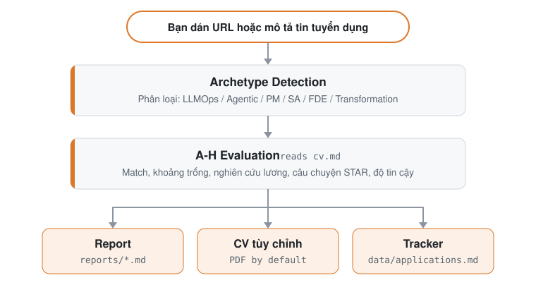

# ReboundOps engine

The job-search data folder and command-line scripts behind the **ReboundOps Workspace** (`../workspace`), part of the [rebound-ops](https://github.com/AnkitParekh007/rebound-ops) monorepo. Start the integrated demo from the repository root with `scripts/start-demo.sh`.

## rebound-ops làm gì cho bạn

Dán một tin tuyển dụng. Nó cho bạn biết buổi tối đó có đáng không.

- **Còn mở không?** Nó kiểm tra tin còn đang tuyển trước khi bạn viết một chữ.
- **Không hợp với bạn?** Nó chấm điểm vai trò dựa trên CV thật của bạn và khuyên bỏ qua những tin kém phù hợp. Bạn có thể quyết định khác.
- **Đáng không?** Nó soạn nháp CV, cover letter và các câu trả lời. Bạn đọc. Bạn gửi.
- **Nói chuyện với ai?** Nó tìm người phù hợp và soạn nháp tin nhắn. Nó không bao giờ gửi.
- **Mọi thứ nằm ở đâu?** Mọi đơn ứng tuyển ở lại trên máy bạn. Không gì được tải lên cho chúng tôi.
- **Nên học gì?** Sau một chuỗi bị từ chối, nó chỉ ra khoảng trống.

Những lần chạy đầu còn thô. Nó chưa biết bạn. Hãy trò chuyện với nó: CV của bạn, điều bạn muốn, điều bạn từ chối. Hãy coi đó là tuần đầu tiên của một recruiter.

Lần khởi động đầu tiên, nó hỏi tất cả những điều đó ngay trong cuộc trò chuyện. Không cần cấu hình thủ công.

## rebound-ops sẽ không làm gì

- **Tự động nộp đơn ứng tuyển.** Nó soạn nháp câu trả lời cho mọi ô; bạn xem lại và bấm Submit. Script không bao giờ POST (`prepare-application.mjs`).
- **Gửi email.** Chỉ soạn nháp. Không có thành phần gửi thư nào trong codebase này.
- **Gửi dữ liệu về máy chủ của chúng tôi.** Không telemetry, không backend của chúng tôi. CV của bạn đi từ máy bạn tới nhà cung cấp AI bạn chọn, và không đi đâu khác. Sổ cái công khai duy nhất là repo này: `HIRED.md` và các issue của nó.
- **Thúc bạn ứng tuyển khi điểm dưới 4.0/5.** Nó sẽ khuyên bạn đừng. Bạn có thể quyết định khác, và nó sẽ nói rõ điều đó.

Nó diễn đạt lại CV của bạn; nó không bao giờ được bịa ra. Một bước kiểm tra trong mã sẽ chặn PDF có số liệu hoặc thông tin không xuất hiện trong CV hay article digest của bạn, nhưng nó chưa thể đánh giá mọi cách diễn đạt lại. Hãy đọc từng CV trước khi gửi. Chi tiết trong [Câu hỏi thường gặp](#câu-hỏi-thường-gặp).

## Tính năng

| Tính năng                | Mô tả                                                                                                                                    |
| ------------------------ | ---------------------------------------------------------------------------------------------------------------------------------------- |
| **Đánh giá A-H**         | Tóm tắt vai trò, match với CV (kèm mức độ quan trọng của từng yêu cầu đối với tin này, và trọng số đó đến từ chính câu chữ của JD, cấu trúc của nó hay một ước lượng, được gắn nhãn cho từng yêu cầu; một ước lượng không bao giờ được xếp vào mức cao nhất), chiến lược level, nghiên cứu lương, cá nhân hóa, chuẩn bị phỏng vấn (STAR+R) -- cộng thêm kiểm tra độ tin cậy của tin ở Block G (tin còn mở không, có phải tin đăng lại không: quan sát, không phải phán quyết), và tín hiệu Work-Auth đánh dấu JD ghi rõ không bảo lãnh là blocker cứng |
| **Con người trong vòng lặp** | AI đánh giá và đề xuất, bạn quyết định và hành động. Hệ thống không bao giờ nộp đơn ứng tuyển -- bạn luôn là người quyết định cuối cùng <!-- hitl: absolute guarantee. Do not add "automatically", "by itself", "without your permission" or any other hedge when translating this row. --> |
| **Tạo PDF cho ATS**      | CV đọc được bởi ATS, điều chỉnh theo từng JD từ chính kinh nghiệm của bạn, thiết kế Space Grotesk + DM Sans |
| **Tạo Cover Letter**     | Cover letter có nghiên cứu, bám sát từ khóa của JD, bốn câu hỏi định hướng tương tác (vì sao/vấn đề/cách tiếp cận/giọng điệu), bước duyệt bản nháp ngay trong chat, và PDF A4 qua cùng pipeline HTML + Playwright như CV. Tự soạn nháp ở mỗi lần đánh giá; hoàn thiện và tạo theo yêu cầu qua `/rebound-ops cover` |
| **Vượt ra ngoài CV**     | Nghiên cứu công ty ([`deep`](modes/deep.md)) chỉ ra chiến lược AI, các động thái gần đây, văn hóa kỹ thuật và góc tiếp cận hồ sơ của bạn nên chọn. Tìm liên hệ ([`contacto`](modes/contacto.md)) xác định hiring manager, recruiter hoặc đồng nghiệp trong team đáng để tiếp cận và soạn nháp tin nhắn LinkedIn dưới 300 ký tự phù hợp với từng loại liên hệ. Soạn nháp email ứng tuyển chính thức ([`email`](modes/email.md)) biến một báo cáo đã đánh giá hoặc JD dán vào thành dòng tiêu đề, nội dung và danh sách tệp đính kèm mà không gửi, nộp hay bấm bất cứ thứ gì. Đơn ứng tuyển đưa bạn vào hàng đợi; nghiên cứu đưa bạn vào cuộc trò chuyện. |
| **Phân tích mẫu hình**   | Mẫu hình bị từ chối và tỷ lệ tiến tới bước sau theo từng kênh ATS (`analyze-patterns.mjs`), thống kê phễu toàn thời gian (`stats.mjs`), phát hiện tin đăng lại, dấu hiệu có thể của tin ma (`detect-reposts.mjs`) |

<details>
<summary><b>Mọi thứ khác nó làm được</b></summary>

| Tính năng                | Mô tả                                                                                                                                    |
| ------------------------ | ---------------------------------------------------------------------------------------------------------------------------------------- |
| **Auto-Pipeline**        | Dán một URL, nhận đánh giá đầy đủ + PDF + dòng tracker |
| **Kho câu chuyện phỏng vấn** | Tích lũy các câu chuyện STAR+Reflection qua các lần đánh giá -- 5-10 câu chuyện gốc bạn có thể điều chỉnh cho các câu hỏi hành vi |
| **Kịch bản đàm phán**    | Khung đàm phán lương, phản biện việc giảm lương theo địa lý, đòn bẩy từ offer cạnh tranh |
| **Nháp email ứng tuyển** | Email ứng tuyển chính thức tới recruiter/người giới thiệu/cold email từ một báo cáo hoặc JD dán vào, kèm dòng tiêu đề, danh sách tệp đính kèm, các điểm phù hợp có nguồn và khối liên hệ lấy từ hồ sơ. Chỉ soạn nháp -- rebound-ops không bao giờ gửi, nộp hay bấm bất cứ thứ gì. |
| **Scanner cổng việc làm** | 100+ công ty cấu hình sẵn (Anthropic, OpenAI, ElevenLabs, Retool, n8n...) + truy vấn tùy chỉnh trên Ashby, Greenhouse, Lever, Wellfound |
| **Khám phá công ty vừa gọi vốn** | Lệnh `company:funded` ưu tiên xem lại trước hiển thị các công ty vừa gọi vốn và chẩn đoán nguồn từ các feed công khai có cấu trúc mà không sửa dữ liệu của bạn |
| **Xử lý hàng loạt**      | Đánh giá song song với các worker CLI headless (`claude -p` / `opencode run`) |
| **Dashboard TUI**        | Giao diện terminal để duyệt, lọc và sắp xếp pipeline của bạn |
| **Toàn vẹn pipeline**    | Tự động merge, loại trùng, chuẩn hóa trạng thái, kiểm tra sức khỏe |
| **Bộ công cụ phỏng vấn** | Kế hoạch chuẩn bị theo khung giờ, buổi luyện tập có phản hồi, tổng kết sau phỏng vấn ([`interview/`](modes/interview/README.md)), và bộ phát hiện red flag của công ty ([`interview-redflag`](modes/interview-redflag.md)) |
| **Giai đoạn offer**      | Trợ lý đọc hợp đồng -- đi qua từng điều khoản kèm danh sách câu hỏi cho luật sư ([`offer-prep`](modes/offer-prep.md)) -- và bộ phân tích chênh lệch lương mong muốn/quảng cáo/thực tế (`salary-gap.mjs`) |
| **Follow-up và phản hồi** | Bộ tính nhịp follow-up và nhắc nhở gieo sẵn (`followup-cadence.mjs`, `followup-seed.mjs`); phân loại phản hồi của nhà tuyển dụng thành cập nhật tracker ([`reply-watch`](modes/reply-watch.md)) |
| **Hệ thống plugin**      | Tích hợp tùy chọn (Gmail, Notion, Apify + registry cộng đồng), tắt theo mặc định -- xem [docs/PLUGINS.md](docs/PLUGINS.md) |

</details>

## Cách hoạt động

<p align="center"><picture><source media="(prefers-color-scheme: dark)" srcset="docs/how-it-works-vi-dark.svg"></picture></p>

## Bắt đầu nhanh

**Cách nhanh nhất, một lệnh:**

```bash
node engine/scaffolder/bin/cli.mjs init
```

> 💡 `npx` đi kèm [Node.js](https://nodejs.org): nó chạy trình cài đặt một lần,
> mà không cài gì ở cấp toàn cục. Chưa có Node? Hãy cài trước.
> (Đang dùng Claude Code / Gemini / Codex CLI? Vậy là bạn đã có sẵn.)

Lệnh này clone bản phát hành mới nhất vào `./rebound-ops` và cài các phụ thuộc. Sau đó:

```bash
cd rebound-ops
claude   # hoặc codex / qwen / opencode / agy / grok — mở AI CLI của bạn tại đây
```

**Ở lần khởi động đầu tiên, rebound-ops hướng dẫn bạn thiết lập (CV, hồ sơ và vai trò mục tiêu) chỉ bằng cách trò chuyện. Không cần sửa tay gì cả.**

<details>
<summary><b>Muốn tự cài thủ công? (git clone)</b></summary>

```bash
git clone https://github.com/AnkitParekh007/rebound-ops.git
cd rebound-ops && npm install
npx playwright install chromium   # chỉ cần khi tạo PDF
# Trên bản phân phối Linux không phải Debian/Ubuntu (Fedora, Arch, ...), các thư viện
# hệ thống của Chromium không được cài bởi dòng trên — hãy tự cài bằng trình quản lý
# gói của bản phân phối nếu việc tạo PDF không mở được trình duyệt
# (tài liệu của Playwright liệt kê các thư viện cần thiết theo từng nền tảng).

# 2. Mở AI CLI của bạn trong thư mục này. Ở lần khởi động đầu tiên, nó hướng dẫn
#    bạn thiết lập (CV, hồ sơ và vai trò mục tiêu) bằng cách trò chuyện
claude   # hoặc codex / opencode / qwen / agy / grok

# Rồi nhờ CLI của bạn điều chỉnh hệ thống cho phù hợp với bạn:
# "Đổi các archetype sang các vai trò backend engineering"
# "Dịch các mode sang tiếng Việt"
# "Thêm 5 công ty này vào portals.yml"
# "Cập nhật hồ sơ của tôi bằng CV tôi đang dán"

# 3. Bắt đầu dùng
# Dán URL tin tuyển dụng hoặc văn bản JD để kích hoạt auto-pipeline.
# Các mode còn lại, và cách yêu cầu chúng trong CLI của bạn: xem Cách dùng bên dưới.
```

</details>

### Quét qua proxy đi ra ngoài

Nếu bạn quét từ một sandbox chỉ cho đi qua proxy, hãy chạy `REBOUND_OPS_TRUST_PROXY_EGRESS=1 node scan.mjs`. Chỉ đặt cờ này **khi chính proxy được cấu hình đã chặn kết nối tới các địa chỉ riêng tư, loopback và metadata**. Các bước đầy đủ (bằng tiếng Anh) nằm trong [docs/SETUP.md](docs/SETUP.md#scanning-through-an-outbound-proxy).

### Cài toàn cục

```bash
npm i -g ./engine/scaffolder
```

Lệnh này cài binary `rebound-ops` ở cấp toàn cục để bạn chạy `rebound-ops init [folder]` mà không cần `npx`. `init` là lệnh duy nhất của nó: nó dựng một workspace, và mọi việc sau đó diễn ra bên trong AI coding CLI của bạn (xem Cách dùng bên dưới), không qua binary này.

**Nên dùng cách nào?**
- `node engine/scaffolder/bin/cli.mjs init`: tốt nhất cho lần dùng đầu; tạo một thư mục dự án riêng.
- `npm i -g ./engine/scaffolder`: nếu bạn thích gõ `rebound-ops init` hơn dạng `npx`. Nó không thêm lệnh nào khác.

### Những cách khác để chạy

- **Từ bất kỳ thư mục nào, dưới dạng plugin Claude Code:** [docs/CLAUDE_PLUGIN.md](docs/CLAUDE_PLUGIN.md).
- **Không cần AI CLI:** các script độc lập cho Gemini, Ollama và các mô hình tương thích OpenAI tự đánh giá một JD. Xem [docs/SCRIPTS.md](docs/SCRIPTS.md#geminieval--ollamaeval--openaieval).

> **Hệ thống được thiết kế để chính AI coding CLI của bạn tùy chỉnh.** Mode, archetype, trọng số chấm điểm, kịch bản đàm phán -- chỉ cần nhờ nó thay đổi. Nó đọc chính những file nó dùng, nên biết chính xác cần sửa gì.

Xem [docs/SETUP.md](docs/SETUP.md) để có hướng dẫn thiết lập đầy đủ, [docs/RUNNING_ON_A_BUDGET.md](docs/RUNNING_ON_A_BUDGET.md) để chạy rebound-ops với chi phí thấp bằng mô hình tùy chỉnh hoặc cục bộ (và [docs/FREE_TIER.md](docs/FREE_TIER.md) để chạy với chi phí bằng không trên gói miễn phí của Antigravity CLI), [docs/AUTOMATION.md](docs/AUTOMATION.md) để lên lịch quét định kỳ và công thức phân loại tới shortlist không tốn token, [docs/APPLY_AUTOFILL.md](docs/APPLY_AUTOFILL.md) để biết chi tiết luồng tự điền ATS, [docs/LINKEDIN_JOIN.md](docs/LINKEDIN_JOIN.md) để đối chiếu bản xuất danh sách kết nối LinkedIn với các công ty trong phễu của bạn, và [docs/FAQ.md](docs/FAQ.md) cho câu trả lời về các câu hỏi thiết lập thường gặp, gồm cả [cách nguồn gốc câu chuyện ngăn việc bịa số liệu](docs/FAQ.md#why-does-rebound-ops-refuse-to-use-a-number-from-my-story-bank). Nguyên tắc thiết kế nằm ở [ARCHITECTURE.md](ARCHITECTURE.md); luồng chạy ở [docs/ARCHITECTURE.md](docs/ARCHITECTURE.md).

## Cách dùng

Dán URL hoặc mô tả công việc vào AI CLI của bạn. rebound-ops kiểm tra xem tin tuyển dụng có liên kết còn mở hay không (văn bản dán vào không có liên kết để kiểm tra), chấm điểm tin đó so với CV của bạn, viết báo cáo, tùy chỉnh CV của bạn (mặc định là PDF) và thêm một dòng vào tracker của bạn. Chừng đó là đủ cho phần lớn các ngày. Mọi thứ còn lại là các mode mà bạn gọi bằng tên. Nếu không đọc được một tin tuyển dụng, pipeline sẽ dừng lại và yêu cầu bạn dán văn bản.

### Cách gọi một mode

| CLI | Cách gọi `scan` |
| --- | --- |
| Claude Code, OpenCode, Antigravity CLI (`agy`), Grok Build CLI | `/rebound-ops scan` |
| Pi | `/skill:rebound-ops scan` |
| Codex, Qwen, Cursor hoặc bất kỳ CLI nào khác được hỗ trợ | Ngôn ngữ thường: "Run the rebound-ops scan mode" |

`/rebound-ops` đứng một mình sẽ hiện menu lệnh trong các CLI dùng lệnh này. Ngôn ngữ thường dùng được trong mọi CLI được hỗ trợ. Khi dùng như plugin của Claude Code, lệnh là `/rebound-ops:rebound-ops`.

Tất cả đều dùng chung một router, `.agents/skills/rebound-ops/SKILL.md`, và cùng các tệp `modes/*.md`, nên mọi CLI đều chuyển yêu cầu theo cùng một cách (các mode dùng nhiều trình duyệt cũng cần công cụ Playwright). Slash command không được đảm bảo trong Codex: hãy yêu cầu bằng ngôn ngữ thường, hoặc chạy một prompt ở chế độ headless bằng `codex exec "Evaluate this JD with rebound-ops auto-pipeline: https://company.com/jobs/123"` ([docs/CODEX.md](docs/CODEX.md)). Cách chạy trong từng CLI được hỗ trợ, lệnh headless với những CLI có lệnh này, và các ghi chú thiết lập riêng cho từng CLI nằm trong [docs/SUPPORTED_CLIS.md](docs/SUPPORTED_CLIS.md).

### Các lệnh dùng hằng ngày

| Lệnh | Chức năng |
| --- | --- |
| *dán URL hoặc JD* | Pipeline đầy đủ: kiểm tra tin còn mở hay không (chỉ với URL), đánh giá A-G cộng H khi điểm cao, báo cáo, CV đã tùy chỉnh (mặc định là PDF), một dòng trong tracker |
| `scan` | Quét các cổng của bạn để tìm tin mới và thêm vào hộp thư (`data/pipeline.md`) |
| `pipeline` | Xử lý các URL đang chờ trong hộp thư (mức standard và premium có thể bỏ qua những URL rõ ràng không phù hợp) |
| `apply` | Cùng bạn điền form ứng tuyển, từng trường một. Dừng lại trước khi Gửi |
| `tracker` | Mỗi hồ sơ ứng tuyển đang ở đâu |
| `followup` | Hồ sơ nào đến lúc cần follow-up, kèm bản nháp |

<details>
<summary><b>Tất cả các lệnh, theo giai đoạn tìm việc</b></summary>

`oferta`, `ofertas` và `contacto` giữ nguyên tên gốc tiếng Tây Ban Nha: offer, nhiều offer, liên hệ.

**Tìm vị trí**

| Lệnh | Chức năng |
| --- | --- |
| [`scan`](modes/scan.md) | Quét các cổng và tìm tin mới |
| [`discover`](modes/discover.md) | Chuyển danh sách tên công ty thành các bảng ATS có thể quét. Mặc định chỉ xem trước; chỉ thêm vào `portals.yml` khi dùng `--write` (không tốn token) |
| [`pipeline`](modes/pipeline.md) | Xử lý các URL đang chờ trong hộp thư (`data/pipeline.md`) |
| [`triage`](modes/triage.md) | Lọc nhanh lần đầu theo kiểu nên hay không nên ứng tuyển dựa trên `modes/_brief.md`, trước khi đánh giá đầy đủ (không ghi tệp nào) |
| [`batch`](modes/batch.md) | Đánh giá nhiều tin bằng các worker headless (song song với Claude, lần lượt từng tin với các CLI khác) |
| [`titles`](modes/titles.md) | Gợi ý các chức danh liên quan từ CV của bạn để mở rộng tìm kiếm |

**Đánh giá một vị trí**

| Lệnh | Chức năng |
| --- | --- |
| *dán URL hoặc JD* | [Auto-pipeline](modes/auto-pipeline.md): đánh giá + báo cáo + CV đã tùy chỉnh (mặc định là PDF) + mục trong tracker |
| [`oferta`](modes/oferta.md) | Chỉ đánh giá, các block A đến G cộng H khi điểm cao (không có PDF) |
| [`ofertas`](modes/ofertas.md) | So sánh và xếp hạng nhiều offer |
| [`deep`](modes/deep.md) | Prompt nghiên cứu chuyên sâu về công ty |
| [`eu-swe`](modes/regional/eu-swe.md) | Hiệu chỉnh một hồ sơ ứng tuyển kỹ sư phần mềm ở châu Âu trước khi làm CV, nộp đơn hoặc phỏng vấn |

**Ứng tuyển**

| Lệnh | Chức năng |
| --- | --- |
| [`pdf`](modes/pdf.md) | CV tối ưu cho ATS dưới dạng PDF |
| [`ats`](modes/ats.md) | Kiểm tra mức thân thiện với ATS của CV đã tạo: điểm số và các vấn đề có thể sửa |
| [`text`](modes/text.md) | CV đã tùy chỉnh dưới dạng markdown (phản chiếu `cv.md`, không có PDF) |
| [`latex`](modes/latex.md) | Xuất CV thành `.tex` LaTeX/Overleaf |
| [`latex-tex`](modes/latex-tex.md) | Tùy chỉnh `resume.tex` của chính bạn ngay tại chỗ (tùy chọn; `cv.md` vẫn là mặc định) |
| [`cover`](modes/cover.md) | Thư xin việc, từ một JD đã dán hoặc một báo cáo đã đánh giá (`cover {slug}`) |
| [`email`](modes/email.md) | Bản nháp email ứng tuyển trang trọng. Chỉ là bản nháp: không bao giờ gửi, nộp hay bấm nút |
| [`contacto`](modes/contacto.md) | Tìm hiring manager, recruiter hoặc một đồng nghiệp cùng ngành, rồi soạn nháp tin nhắn LinkedIn |
| [`apply`](modes/apply.md) | Trợ lý ứng tuyển trực tiếp (Playwright từ checkout này). Không tự nộp |

**Phỏng vấn**

| Lệnh | Chức năng |
| --- | --- |
| [`interview-prep`](modes/interview-prep.md) | Tài liệu chuẩn bị phỏng vấn riêng cho từng công ty |
| [`interview/plan`](modes/interview/plan.md) | Kế hoạch chuẩn bị chia theo khung giờ cho một buổi phỏng vấn sắp tới |
| [`interview/practice`](modes/interview/practice.md) | Phỏng vấn thử, mỗi lần một câu hỏi, kèm phản hồi |
| [`interview/debrief`](modes/interview/debrief.md) | Tổng kết sau phỏng vấn: bù đắp thiếu sót, dự đoán vòng tiếp theo |
| [`interview-redflag`](modes/interview-redflag.md) | Phân tích các dấu hiệu cảnh báo của nhà tuyển dụng trước khi bạn gia nhập |

**Sau khi ứng tuyển**

| Lệnh | Chức năng |
| --- | --- |
| [`tracker`](modes/tracker.md) | Tổng quan trạng thái ứng tuyển |
| [`followup`](modes/followup.md) | Nhịp follow-up: đánh dấu hồ sơ quá hạn, tạo bản nháp |
| [`reply-watch`](modes/reply-watch.md) | Phân loại phản hồi của nhà tuyển dụng và đề xuất cập nhật tracker |
| [`outcome`](modes/outcome.md) | Ghi lại kết quả của một hồ sơ ứng tuyển và lưu trữ các tài liệu liên quan |
| [`offer-prep`](modes/offer-prep.md) | Cùng bạn đọc một offer hoặc hợp đồng đã nhận: duyệt từng điều khoản và các câu hỏi dành cho luật sư (không phải tư vấn pháp lý) |

**Hồ sơ và CV của bạn**

| Lệnh | Chức năng |
| --- | --- |
| [`interview`](modes/interview.md) | Thiết lập hồ sơ: một buổi phỏng vấn tương tác về kinh nghiệm của bạn để xây dựng CV và hồ sơ (không phải luyện phỏng vấn) |
| [`intake`](modes/intake.md) | Xây dựng hoặc bổ sung hồ sơ của bạn từ các tệp trong `documents/` (CV gốc, bản xuất LinkedIn). Không có gì được ghi nếu bạn chưa xác nhận |
| [`master-profile`](modes/master-profile.md) | Nhập, rà soát và xác thực Master Career Profile của bạn, rồi chuẩn bị các dữ kiện được chọn thành các gạch đầu dòng trong CV |
| [`add`](modes/add.md) | Thêm một dự án, bài báo hoặc vai trò vào CV (lấy, xem trước, xác nhận) |
| [`expand`](modes/expand.md) | Tìm các năng lực còn thiếu trong CV, dựa trên các liên kết trong hồ sơ của bạn |
| [`retro`](modes/retro.md) | Xem lại phiên này và giữ những gì bạn đã dạy làm quy tắc (chỉ ghi những quy tắc bạn chấp nhận) |

**Cải thiện định hướng của bạn**

| Lệnh | Chức năng |
| --- | --- |
| [`patterns`](modes/patterns.md) | Phân tích các mẫu bị từ chối và cải thiện định hướng |
| [`calibrate`](modes/calibrate.md) | Kiểm tra xem điểm đánh giá của bạn có dự đoán được kết quả thực tế hay không. Chỉ mang tính tham khảo: không bao giờ thay đổi cách chấm điểm |
| [`upskill`](modes/upskill.md) | Phân tích khoảng trống kỹ năng trên các báo cáo đã đánh giá của bạn |
| [`training`](modes/training.md) | Đánh giá một khóa học hoặc chứng chỉ so với North Star của bạn |
| [`project`](modes/project.md) | Đánh giá một ý tưởng dự án cho portfolio |

**Hệ thống**

| Lệnh | Chức năng |
| --- | --- |
| [`agent-inbox`](modes/agent-inbox.md) | Xếp hàng các yêu cầu cho phiên sau và xử lý chúng lúc đó (`data/agent-inbox.md`). `inbox` cũng dùng được |
| [`update`](modes/update.md) | Cập nhật các tệp hệ thống của rebound-ops, kèm xem trước diff và kiểm tra tương thích |

</details>

## Các cổng đã cấu hình sẵn

Scanner đi kèm **100+ công ty** sẵn sàng quét và **35+ truy vấn tìm kiếm** trên các cổng việc làm lớn. Sao chép `templates/portals.example.yml` thành `portals.yml` và thêm của riêng bạn:

**Phòng thí nghiệm AI:** Anthropic, OpenAI, Mistral, Cohere, LangChain, Pinecone
**AI giọng nói:** ElevenLabs, PolyAI, Parloa, Hume AI, Deepgram, Vapi, Bland AI
**Nền tảng AI:** Retool, Airtable, Vercel, Temporal, Glean, Arize AI
**Contact Center:** Ada, LivePerson, Sierra, Decagon, Talkdesk, Genesys
**Doanh nghiệp:** Salesforce, Twilio, Gong, Dialpad
**LLMOps:** Langfuse, Weights & Biases, Lindy, Cognigy, Speechmatics
**Tự động hóa:** n8n, Zapier, Make.com
**Châu Âu:** Factorial, Attio, Tinybird, Clarity AI, Travelperk

**Cổng việc làm được tìm:** 55+ module provider bao phủ API của ATS, feed toàn cổng, feed XML/RSS, feed markdown và bộ phân tích cục bộ. Xem [Các cổng việc làm được hỗ trợ](docs/SUPPORTED_JOB_BOARDS.md) để có bảng đầy đủ.

Theo mặc định `node scan.mjs` (hay `npm run scan`) tin vào những gì mỗi feed ATS trả về. Một số công ty để lại tin cũ trong API công khai ngay cả sau khi vai trò đã đóng, nên các mục hết hạn đó có thể lọt vào `pipeline.md`. Truyền `--verify` để khởi chạy Playwright sau lượt API và loại bỏ tin hết hạn trước khi chúng vào pipeline:

```bash
node scan.mjs --verify          # khám phá không tốn token + kiểm tra còn mở bằng Playwright
```

Việc xác minh chạy tuần tự và chỉ áp dụng cho tin mới (sau khi loại trùng), nên chi phí luôn có giới hạn.

## Dashboard TUI

Dashboard terminal tích hợp cho phép bạn duyệt pipeline một cách trực quan:

```bash
npm run serve:dashboard   # chạy TUI
npm run build:dashboard   # tùy chọn: build binary độc lập
```

Tính năng: 10 tab lọc, 8 kiểu sắp xếp, chế độ nhóm/phẳng, xem trước tải lười, đổi trạng thái ngay trong danh sách.

Ngoài ra còn có một **giao diện web thử nghiệm** (alpha và tùy chọn: không gì chạy trừ khi bạn khởi động): xem [`web/README.md`](web/README.md).

## Cấu trúc dự án

```
rebound-ops/
├── AGENTS.md                    # Hướng dẫn agent chuẩn (mọi CLI)
├── CLAUDE.md                    # Lớp bọc cho Claude Code (import AGENTS.md)
├── CODEX.md                     # Lớp bọc cho Codex (import AGENTS.md)
├── OPENCODE.md                  # Lớp bọc cho OpenCode (import AGENTS.md)
├── GEMINI.md                    # Lớp bảo vệ cũ không làm gì, tránh Antigravity nhân đôi ngữ cảnh
├── cv.md                        # CV của bạn (tự tạo)
├── article-digest.md            # Các proof point của bạn (tùy chọn)
├── config/
│   └── profile.example.yml      # Mẫu hồ sơ của bạn
├── modes/                       # Các skill mode
│   ├── _shared.md               # Ngữ cảnh dùng chung (tùy chỉnh file này)
│   ├── oferta.md                # Đánh giá một tin
│   ├── pdf.md                   # Tạo PDF
│   ├── cover.md                 # Tạo cover letter
│   ├── email.md                 # Soạn nháp email ứng tuyển chính thức
│   ├── scan.md                  # Scanner cổng việc làm
│   ├── batch.md                 # Xử lý hàng loạt
│   └── ...
├── templates/
│   ├── cv-template.html         # Mẫu CV tối ưu cho ATS
│   ├── portals.example.yml      # Mẫu cấu hình scanner
│   └── states.yml               # Các trạng thái chuẩn
├── batch/
│   ├── batch-prompt.md          # Prompt worker tự chứa
│   └── batch-runner.sh          # Script điều phối
├── dashboard/                   # Trình xem pipeline TUI bằng Go
├── data/                        # Dữ liệu theo dõi của bạn (gitignored)
├── reports/                     # Báo cáo đánh giá (gitignored)
├── output/                      # PDF đã tạo (gitignored)
├── fonts/                       # Space Grotesk + DM Sans
├── docs/                        # Thiết lập, tùy chỉnh, hướng dẫn tiết kiệm, kiến trúc
└── examples/                    # CV, báo cáo, proof point mẫu
```

## Thư mục dữ liệu bên ngoài (tùy chọn)

Theo mặc định, dữ liệu lớp người dùng (như `cv.md`, `portals.yml` và các thư mục `data/` / `reports/` / `output/`) nằm trong thư mục gốc dự án.

Để tách dữ liệu cá nhân khỏi mã (giúp dễ đổi nhánh, kéo bản cập nhật hoặc thử nhiều hồ sơ), bạn có thể cấu hình một thư mục dữ liệu bên ngoài theo thứ tự ưu tiên sau:

1. **Biến môi trường:** Đặt biến môi trường `REBOUND_OPS_ROOT` hoặc `REBOUND_OPS_DATA_DIR`:
   ```bash
   export REBOUND_OPS_ROOT=~/my-career-data
   ```
2. **File đánh dấu:** Tạo file `.rebound-ops-data` ở thư mục gốc repo chứa đường dẫn tới thư mục dữ liệu của bạn.
3. **Mặc định:** Mặc định là thư mục gốc repo.

Sau khi xác định xong, mọi file người dùng được đọc và ghi tương đối với thư mục đó, trong khi các file prompt và script tiếp tục được xác định tương đối với repo.

- **Ghi đè tracker:** Bạn cũng có thể đặt `REBOUND_OPS_TRACKER` để ghi đè trực tiếp đường dẫn file tracker đơn ứng tuyển.
- **Ghi:** Mọi thao tác ghi (như merge) mặc định nhắm tới `{DATA_ROOT}/data/applications.md`.
- **Cấu hình scanner:** `portals.yml` được đọc và kiểm tra tại `{DATA_ROOT}/portals.yml`, nên `node validate-portals.mjs` kiểm tra đúng file mà `scan.mjs` đọc.
- **Tài liệu được tạo:** CV và cover letter đã điều chỉnh được ghi dưới `{DATA_ROOT}/output/`, và manifest PDF liên kết chúng với một báo cáo nằm ở `{DATA_ROOT}/data/pdf-index.tsv`. Khi `REBOUND_OPS_TRACKER` chưa đặt, workspace tracker giới hạn các lần ghi đó là thư mục dữ liệu, không phải thư mục checkout.
- **PDF khi ghi đè tracker:** `generate-pdf.mjs` xác định `REBOUND_OPS_TRACKER` trước khi suy ra workspace, nên khi có ghi đè, workspace là thư mục chứa tracker đó (hoặc thư mục cha của nó, khi tracker nằm trong thư mục `data/`). Khi đó HTML của CV và mọi PDF phải nằm trong workspace này, và manifest chuyển sang `data/pdf-index.tsv` của nó. Cover letter vẫn nhắm tới `{DATA_ROOT}/output/`, nên bị từ chối khi thư mục đó nằm ngoài workspace của tracker.
- **Lớp mã giữ nguyên chỗ:** `node_modules/`, `providers/`, `modes/` và chính các script luôn được xác định theo repo, không bao giờ theo thư mục dữ liệu.

TUI dashboard viết bằng Go, các script Node.js và các mode của AI agent đều tự động tuân theo thứ tự ưu tiên này.


## Công nghệ


- **Agent**: AI coding CLI với skill và mode dùng chung (`AGENTS.md` + lớp bọc CLI)
- **PDF**: Playwright + mẫu HTML
- **Cover letter**: mẫu HTML + Playwright (PDF A4, cùng pipeline với CV)
- **Scanner**: Playwright + Greenhouse API + WebSearch
- **Dashboard**: Go + Bubble Tea + Lipgloss (giao diện Catppuccin Mocha)
- **Dữ liệu**: bảng Markdown + cấu hình YAML + file batch TSV

<p align="center">
</p>

<p align="center">
  <a href="https://claude.com/claude-code"></a>
</p>

<p align="center">
  <sub>Cũng chạy trên mọi CLI theo chuẩn agent-skill. Xem <a href="docs/SUPPORTED_CLIS.md">Các CLI được hỗ trợ</a>.</sub><br>
  
  
  
  
  
  
  
  
  
  <br>
  
  
  
  
  
  <a href="TRADEMARK.md"></a>
</p>

## Câu hỏi thường gặp

**rebound-ops là gì?**
**CV đã điều chỉnh có thể bịa ra thông tin không?**
Không được phép, và các prompt đã nói rõ: diễn đạt lại, không bao giờ bịa. `generate-pdf` chặn CV có số liệu hoặc thông tin không có trong nguồn của bạn, trừ khi bạn truyền `--skip-fact-check`. Chế độ `pdf` cũng chạy `cv-title-check.mjs`, công cụ so sánh từng chức danh trong CV đã tùy chỉnh với chức danh mà cv.md ghi cho cùng công việc đó (ghép theo công ty và thời gian), rồi hỏi bạn muốn giữ hay đổi lại chức danh nào khác biệt. Nó chỉ cảnh báo chứ không chặn, vì diễn đạt lại một chức danh đôi khi là quyết định của bạn. Chưa có gì đánh giá cách diễn đạt lại: [#1411](https://github.com/AnkitParekh007/rebound-ops/issues/1411) (kiểm tra tính trung thực theo hướng chặn khi lỗi) đang theo dõi việc này. Cho đến lúc đó, hãy đọc từng CV trước khi gửi. [Tuyên bố miễn trừ pháp lý](LEGAL_DISCLAIMER.md) nói điều tương tự bằng lời dài hơn.

**Tôi có thể chạy rebound-ops miễn phí, hoặc trên mô hình rẻ hơn / cục bộ không?**
Được. rebound-ops không phụ thuộc CLI và chạy được trên mô hình miễn phí và cục bộ (mô hình miễn phí của OpenRouter, Ollama hoặc bất kỳ endpoint tương thích OpenAI nào), nên bạn không bị ràng buộc với gói trả phí. Xem [docs/RUNNING_ON_A_BUDGET.md](docs/RUNNING_ON_A_BUDGET.md) để biết cách thiết lập đầy đủ.

**Tôi trả phí Claude Pro/Max nhưng rebound-ops lại đang tiêu tín dụng API. Vì sao?**
Vì `ANTHROPIC_API_KEY` trong môi trường của bạn được ưu tiên hơn gói đăng ký đã đăng nhập: CLI dùng key và tính phí theo token. Chạy `echo $ANTHROPIC_API_KEY`, và nếu nó in ra bất cứ thứ gì, hãy xóa khỏi shell profile, khởi động lại terminal và chạy `/login`. Chế độ batch là ngoại lệ, vì worker `claude -p` không dùng đăng nhập tương tác: chạy `claude setup-token` một lần và export kết quả thành `CLAUDE_CODE_OAUTH_TOKEN`. Hướng dẫn đầy đủ trong [docs/RUNNING_ON_A_BUDGET.md](docs/RUNNING_ON_A_BUDGET.md#2b-already-paying-for-a-subscription-make-sure-you-are-using-it).

**rebound-ops chạy với những AI CLI nào?**
rebound-ops chạy trên mọi AI coding CLI lớn (Claude Code, Codex, Gemini / Antigravity, OpenCode, Grok, Qwen và nhiều CLI khác) thông qua chuẩn mở Agent Skill Standard, nên không bao giờ bị khóa vào một nhà cung cấp. Hãy dùng CLI bạn đã có.

**Cài rebound-ops trên Windows thế nào?**
rebound-ops chạy được trên Windows. Thiết lập riêng cho nền tảng và các điểm dễ vấp (tìm Git Bash, ký tự xuống dòng, Task Scheduler) nằm trong [docs/WINDOWS.md](docs/WINDOWS.md). Nếu skill không nạp được do lỗi symlink khi cài, cách sửa nằm trong [docs/FAQ.md](docs/FAQ.md). Các bước đầy đủ có trong [docs/SETUP.md](docs/SETUP.md).

**rebound-ops có tự động ứng tuyển thay tôi không?**
Không. rebound-ops là một bộ lọc, không phải công cụ tự ứng tuyển hàng loạt. AI đánh giá, xếp hạng và soạn nháp; bạn xem lại và quyết định. Nó soạn và điền; nó không bao giờ nộp. Bạn bấm Submit. Thiết kế có con người trong vòng lặp đó chính là cốt lõi.

**rebound-ops có miễn phí và mã nguồn mở không?**
The source is MIT-licensed; optional AI providers may charge separately. See [product principles](../docs/principles.md).
## Miễn trừ trách nhiệm

**rebound-ops là một công cụ cục bộ, mã nguồn mở, KHÔNG phải dịch vụ được lưu trữ.** Khi dùng phần mềm này, bạn thừa nhận:

1. **Bạn kiểm soát dữ liệu của mình.** CV, thông tin liên hệ và dữ liệu cá nhân của bạn ở lại trên máy bạn và được gửi trực tiếp tới nhà cung cấp AI bạn chọn (Anthropic, OpenAI, v.v.). Chúng tôi không thu thập, lưu trữ hay truy cập bất kỳ dữ liệu nào của bạn.
2. **Bạn kiểm soát AI.** Các prompt mặc định yêu cầu AI không tự động nộp đơn, nhưng mô hình AI có thể hành xử khó đoán. Nếu bạn sửa prompt hoặc dùng mô hình khác, bạn tự chịu rủi ro. **Luôn xem lại nội dung do AI tạo ra để đảm bảo chính xác trước khi nộp.**
3. **Bạn tuân thủ điều khoản dịch vụ của bên thứ ba.** Bạn phải dùng công cụ này theo Điều khoản dịch vụ của các cổng việc làm bạn tương tác (Greenhouse, Lever, Workday, LinkedIn, v.v.). Không dùng công cụ này để spam nhà tuyển dụng hay làm quá tải hệ thống ATS.
4. **Không có đảm bảo.** Đánh giá là khuyến nghị, không phải sự thật. Mô hình AI có thể bịa ra kỹ năng hoặc kinh nghiệm. Các tác giả không chịu trách nhiệm về kết quả việc làm, đơn bị từ chối, hạn chế tài khoản hay bất kỳ hậu quả nào khác.

Xem [LEGAL_DISCLAIMER.md](LEGAL_DISCLAIMER.md) để biết chi tiết. Phần mềm này được cung cấp theo [Giấy phép MIT](LICENSE) "nguyên trạng", không kèm bất kỳ bảo hành nào.

## License

MIT — see [LICENSE](LICENSE). Dependency and redistribution notes are in [../THIRD_PARTY_NOTICES.md](../THIRD_PARTY_NOTICES.md).
